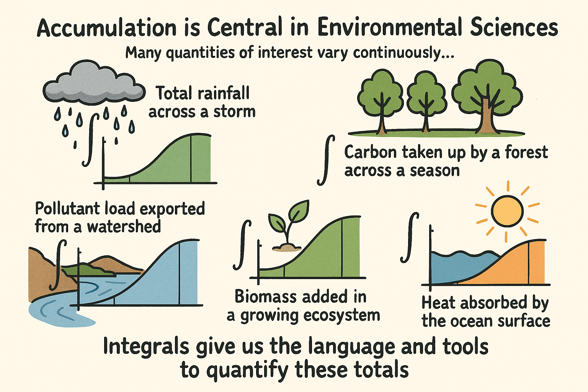
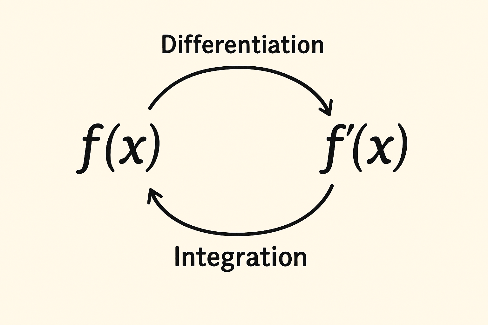

# Introduction to Calculus II

Snow on the Cascades melts a few millimeters a day in April and a lot faster in June. The melt rate matters, but it isn't what water managers plan around. They plan around the total: how much water will come off the mountains this year, and when.

That's the shift in this course. In Calculus I you asked how fast something is changing. In Calculus II you ask how much has built up.

Welcome to Calculus II.

This course is the second half of the **QSci 291–292 sequence**. The math is the same math used across biology, ecology, conservation, marine science and environmental science. We'll spend as much time on what a result means as on how to get it, because a number you can't explain isn't worth much.

By the end of this course, you will be able to:

- **Explain and interpret** definite integrals using Riemann sums, limits and graphs
- **Compute and apply** integrals using substitution, integration by parts, partial fractions and numerical methods
- **Model** natural systems with simple differential equations, including exponential and logistic growth
- **Show your reasoning** in words, numbers and graphs, so someone else can follow it and check it

---

## What Calculus II Is About

Calculus II is about **accumulation**. Water, heat, nutrients, biomass, pollutants: most of what you measure in the environment changes continuously. If you know the rate, how do you get the total gained or lost?

Calculus I asked: *how fast is something changing?* Calculus II asks: *how much has accumulated?* The two questions are linked by the Fundamental Theorem of Calculus. We'll get there in Chapter 4.

| System | Calc I Question (rate) | Calc II Question (total) |
|--------|------------------------|--------------------------|
| **Hydrology** | How fast is streamflow rising during a storm? | How much water flowed past the gauge? |
| **Forests** | How fast is the canopy taking up CO₂ right now? | How much carbon did the stand take up this summer? |
| **Fisheries** | How many salmon per day are passing the weir this week? | How many fish passed the weir over the whole run? |
| **Toxicology** | How quickly is a contaminant entering a lake? | How much contaminant has accumulated by year-end? |

::: promptbox

### Example: Accumulating Rainfall in a Simple Storm {-}

Start simple. A 3-hour storm, with rainfall intensity constant within each hour:

- Hour 1: 4 mm/hour
- Hour 2: 7 mm/hour
- Hour 3: 5 mm/hour

Each hour contributes rate × time:

\[
\text{Total rainfall} = (4)(1) + (7)(1) + (5)(1) = 16 \text{ mm}.
\]

Each bar below is the rain added in one hour. The total is the sum of the three blocks.

```{r simple-storm, echo=FALSE, warning=FALSE, message=FALSE, fig.alt="Bar chart of a 3-hour storm. Rainfall rate is 4 mm per hour in hour 1, 7 in hour 2 and 5 in hour 3."}
# Hourly rainfall rates (mm/hour)
rates <- c(4, 7, 5)

barplot(
  rates,
  names.arg = c("Hour 1", "Hour 2", "Hour 3"),
  ylab = "Rainfall rate (mm/hour)",
  main = "A Simple 3-Hour Storm with Constant Intensities",
  col = "skyblue"
)
```

Easy, because each hour adds a fixed amount.

---

### When Rainfall Intensity Is Not Constant {-}

Real storms don't work like that. Intensity rises and falls as storm cells pass over. Instead of three flat bars, you get a curve.

```{r varying-storm, echo=FALSE, warning=FALSE, message=FALSE, fig.alt="Line graph of rainfall rate over 3 hours. The rate rises and falls repeatedly between about 1 and 7 mm per hour."}
# Time sequence from 0 to 3 hours
t <- seq(0, 3, length.out = 500)

# A wiggly function to mimic a realistic storm
intensity <- 4 + 2*sin(3*t) + 1.5*cos(5*t)

plot(
  t, intensity,
  type = "l",
  lwd = 2,
  col = "blue",
  xlab = "Time (hours)",
  ylab = "Rainfall rate (mm/hour)",
  main = "A Realistic Storm with Continuously Varying Intensity"
)
```

Which leads to the central question of the course:

**How much total rain falls during a storm like this?**

There are no hourly blocks to add up anymore. The rate never sits still. To get the total, we need a way to add up a lot of small, changing contributions.

:::

That idea, big totals built from small pieces, is the starting point for Riemann sums and definite integrals. It comes up in every chapter.

### Concept Check: Rate vs. Total {-}

For each question below, decide whether the quantity is a **rate of change** (derivative-flavored) or an **accumulation** (integral-flavored).

**1. A weather station reports that rain is currently falling at 8 mm/hour. Is this a rate or an accumulation?**

<details>
<summary><strong>Click to reveal answer</strong></summary>

A **rate**. It tells you how fast water is arriving *right now*, in mm per hour.

</details>

**2. A storm has produced 42 mm of rain over the past 6 hours. Is this a rate or an accumulation?**

<details>
<summary><strong>Click to reveal answer</strong></summary>

An **accumulation**. It's the *total* rain that has piled up over a period of time.

</details>

**3. A salmon counting station records that fish are passing at 120 fish per day during the peak of the run. Is this a rate or an accumulation?**

<details>
<summary><strong>Click to reveal answer</strong></summary>

A **rate**. Fish per day is a rate, no matter how many days the run lasts.

</details>

**4. Over the whole season, 38,000 salmon passed the counting station. Is this a rate or an accumulation?**

<details>
<summary><strong>Click to reveal answer</strong></summary>

An **accumulation**. The seasonal total is what you get by adding up the daily counts: an integral of the rate over the season.

</details>

---

## What You Bring From Calculus I

You already have most of what you need. From Calculus I you have:

- reading and interpreting graphs
- derivatives as rates of change
- spotting when a quantity is increasing, decreasing, leveling off or turning around
- working with functions and equations

The thing that trips people up in 292 usually isn't the calculus. It's the algebra. Rearranging, factoring, simplifying and solving for unknowns show up in almost every problem. If those feel shaky, fix them now, and keep track of units as you go.

{fig.cap="" fig.alt="A conceptual illustration of accumulation: small contributions adding up to a total." style="float:center; width:450px; margin:10px;"}

---

## Three Big Ideas

### Accumulation

Most environmental processes happen gradually. Rain builds up drop by drop. A stream carries nutrients continuously. A forest takes up carbon all day as the light changes. The total is the sum of a huge number of small contributions.

Integrals are how you add those up when the rate changes over time, space or depth. In environmental science the total is often the number that matters most. A single reading tells you about one moment.

Three examples to keep in mind:

- **Nitrogen export from a watershed.** Streamflow and nutrient concentration both change during a storm. The total mass exported is *not* peak concentration times storm length. You have to add up the changing contributions as the water moves through.
- **Phytoplankton production over a day.** Photosynthesis follows light, and light changes with cloud cover and sun angle. Daily production is the sum of all the small amounts of carbon fixed through the day.
- **Heat exchange in the ocean mixed layer.** Heat flux changes with wind, sunlight and water temperature. To know how much energy went in or out, you add up the small changes over time.

### Concept Check: Recognizing Accumulation {-}

For each of the following, ask yourself: *am I being told a rate, or a total?*

**1. A research vessel logs that sea-surface heat flux into the mixed layer was 180 W/m² yesterday at noon. To find the total energy that entered a 1 m² patch of ocean over a 24-hour period, what kind of operation do you need to do?**

<details>
<summary><strong>Click to reveal answer</strong></summary>

You need to **accumulate (integrate)** the heat flux over the 24 hours. The flux is a rate (W/m² = J/s/m²), and adding it up over time gives total energy (J/m²). You could only multiply 180 × 24 × 3600 if the flux were constant, and it isn't: sunlight changes through the day.

</details>

**2. A pollutant enters a lake from a single inflow stream. You have continuous measurements of the inflow rate (m³/s) and the pollutant concentration (mg/L) every minute. To compute the total mass of pollutant delivered to the lake over a week, what are you doing conceptually?**

<details>
<summary><strong>Click to reveal answer</strong></summary>

You're **adding up a lot of small contributions**. Each minute, the rate that mass enters is roughly (concentration) × (flow rate). Multiply that by the length of the interval to get a small mass, then add up all the small masses over the week. That's the structure of an integral.

</details>

---

### Reversing Derivatives

A derivative tells you how something changes at each moment. An integral tells you how much it changed in total. **Antiderivatives** connect the two by running differentiation backwards. That connection is the Fundamental Theorem of Calculus.

{fig.cap="" fig.alt="A simple conceptual diagram showing the relationship between differentiation and integration. On the left is a function f(x); a differentiation arrow points to f'(x). Another arrow goes from right to left, from f'(x) to f(x), labeled integration." style="float:center; width:450px; margin:10px;"}

This matters because in environmental science the rate is usually what you can measure or model:

- how fast a pollutant decays
- how fast heat moves into a lake
- how fast a population grows
- how fast soil uses oxygen

And the total is usually what you actually want:

- how much pollutant is left
- how much heat the lake gained
- how much the population changed
- how much oxygen was used

Antiderivatives get you from the first list to the second.

### Concept Check: From Rate to Total {-}

A field crew measures soil respiration (the rate at which microbes release CO₂) every 15 minutes for a full day. They get a function \(R(t)\), in grams of carbon per square meter per hour, that varies through the day with temperature and moisture.

**1. To get the total carbon released over the 24-hour period, what do they do with \(R(t)\) conceptually?**

<details>
<summary><strong>Click to reveal answer</strong></summary>

They **integrate** \(R(t)\) over the 24 hours. Each small time slice \(\Delta t\) contributes roughly \(R(t)\,\Delta t\) grams of carbon per square meter. Adding up all those slices, in the limit as they get very small, gives the total release.

</details>

**2. Suppose instead they have a function \(C(t)\) that tells them the total carbon released *up to* time \(t\). What does \(C'(t)\) represent?**

<details>
<summary><strong>Click to reveal answer</strong></summary>

\(C'(t)\) is the **rate of carbon release at time \(t\)**, which is exactly \(R(t)\). That's the Fundamental Theorem of Calculus: differentiate the accumulation and you get the rate back.

</details>

---

### Differential Equations

Sometimes you don't have a formula for a quantity at all. You have a rule for how it changes:

- a pollutant breaks down at a rate that depends on how much is left
- a population grows fast when it's small and slows as resources run out
- a pond warms quickly when it's much colder than the air, and slowly as the gap closes

What these have in common: *the current state of the system sets how it changes next*. A **differential equation** writes that rule down as math. It's a relationship between a quantity and its own rate of change.

For now you only need to recognize one. In Chapter 7 you'll solve them, and use them to work out where a system is headed: whether it grows, decays, or settles at an equilibrium.

### Concept Check: Recognizing a Differential Equation {-}

Which of these statements describe a *differential equation*, meaning they express a rate of change in terms of the quantity itself?

**1. "The size of a fish population at year 10 is 4,200 individuals."**

<details>
<summary><strong>Click to reveal answer</strong></summary>

**Not a differential equation.** It's a snapshot of the population at one point in time. There's no rate of change in it.

</details>

**2. "A pollutant decays at a rate proportional to the amount currently present."**

<details>
<summary><strong>Click to reveal answer</strong></summary>

**Yes. This is a differential equation in words.** Mathematically: \(\dfrac{dC}{dt} = -kC\), where \(C\) is the concentration. The rate \(\dfrac{dC}{dt}\) depends on the current amount \(C\).

</details>

**3. "The temperature of a small pond changes at a rate proportional to the difference between the pond temperature and the surrounding air temperature."**

<details>
<summary><strong>Click to reveal answer</strong></summary>

**Yes.** This is Newton's Law of Cooling: \(\dfrac{dT}{dt} = -k(T - T_{\text{air}})\). The rate of change depends on the current temperature.

</details>

---

## Building an Intuition for Accumulation

Before computing any integrals, get a feel for how totals come out of changing rates. Streamflow responds to storms. Photosynthesis follows the sun. Populations grow fast in some conditions and slowly in others.

The picture to keep in your head: **each small slice of time**, or of space, adds a small amount to the total. Add all the slices and you get the total rainfall, the total biomass, the total pollutant exported. That's why the integral looks the way it does.

::: promptbox
```{r rainbow-slices, echo=FALSE, warning=FALSE, message=FALSE, fig.alt="Graph of the curve y equals e to the x from 0 to 2. Six thin colored slices fill the area under the curve between x equals 1 and x equals 1.6."}

# Define the function
f <- function(x) exp(x)

# 6 slices from x = 1 to x = 1.6
edges <- seq(1, 1.6, length.out = 7)

# Semi-transparent rainbow colors
cols <- c(
  rgb(228/255, 3/255,   3/255,   0.5),
  rgb(1,       140/255, 0,       0.5),
  rgb(1,       237/255, 0,       0.5),
  rgb(0,       128/255, 38/255,  0.5),
  rgb(0,       77/255,  255/255, 0.5),
  rgb(117/255, 7/255,   135/255, 0.5)
)

curve(
  f(x), from = 0, to = 2, lwd = 3, col = "black",
  xlab = "x", ylab = "Rate of Change",
  main = "Rainbow Slices Under e^x"
)

for (i in 1:6) {
  x_left  <- edges[i]
  x_right <- edges[i+1]

  polygon(
    c(x_left, x_right, x_right, x_left),
    c(0, 0, f(x_right), f(x_left)),
    col = cols[i],
    border = NA
  )
}

# Redraw the curve on top
curve(f(x), from = 0, to = 2, add = TRUE, lwd = 3, col = "black")

```

Each slice is thin, and its height is the rate at that point. Width times height gives that slice's small contribution. Add up all the slices, then let them get thinner and thinner, and you have an integral.
:::

Graphs do a lot of work in this course. Before any calculation, a graph shows you whether a system is gaining or losing, how fast, and whether the change is steady or jumping around. Get in the habit of sketching first.

### Concept Check: Slicing Up an Accumulation {-}

Suppose you're trying to estimate the total volume of water that flowed past a stream gauge during a 6-hour storm. You have flow measurements (in m³/s) recorded every 15 minutes.

**1. To estimate the total volume, what would you do with each measurement?**

<details>
<summary><strong>Click to reveal answer</strong></summary>

For each 15-minute interval, multiply the flow rate (m³/s) by the length of the interval (15 minutes = 900 seconds). That gives an approximate volume in m³ for that interval. Then add up the volumes across the whole storm. That's a *Riemann sum*: each slice is width × height, and the sum estimates the total.

</details>

**2. If you instead had measurements every 1 minute, would your total be more or less accurate?**

<details>
<summary><strong>Click to reveal answer</strong></summary>

**More accurate.** Smaller slices follow the changes in flow more closely, so you're less likely to miss a sudden surge or assume the rate held steady when it didn't. Shrink the slices toward zero and you get the definite integral.

</details>

---

## Units and Interpretation

Integrals give you real physical quantities, so the units have to work. Three patterns to recognize now:

- Integrating "individuals per year" over time gives "individuals."
- Multiplying concentration (mg/L) by flow (m³/s) gives a load *rate*. Since 1 m³ = 1000 L, mg/L × m³/s = g/s. Integrating that rate over time gives total mass in grams.
- Integrating "W/m²" over time gives energy per area, in joules per square meter.

If your units don't come out as the quantity you were after, something went wrong. Check them every time.

### Concept Check: Tracking Units of an Accumulation {-}

**1. A wind turbine's instantaneous power output is measured in kilowatts (kW = kJ/s). If you integrate this power over a 24-hour period, what are the units of your result?**

<details>
<summary><strong>Click to reveal answer</strong></summary>

You get **energy**. Integrate kW over hours and the natural unit is **kilowatt-hours (kWh)**. Integrate kW (= kJ/s) over seconds and you get **kilojoules (kJ)**. Either way, the "per time" in the rate cancels with the time you integrate over.

</details>

**2. A scientist integrates a function with units of "kg of carbon per hectare per year" over a region measured in hectares, and then over a time interval measured in years. What are the units of the final result?**

<details>
<summary><strong>Click to reveal answer</strong></summary>

**Kilograms of carbon (kg C).** Integrating over hectares cancels the "per hectare" and leaves kg/year. Integrating *that* over years cancels the "per year" and leaves kg.

</details>

---

## Looking Ahead

Next up: Riemann sums, then definite integrals and the Fundamental Theorem, then the techniques for finding antiderivatives, then applications, and finally differential equations. All the way through, the question is the same: you know how fast something is changing, so how much has it changed?
