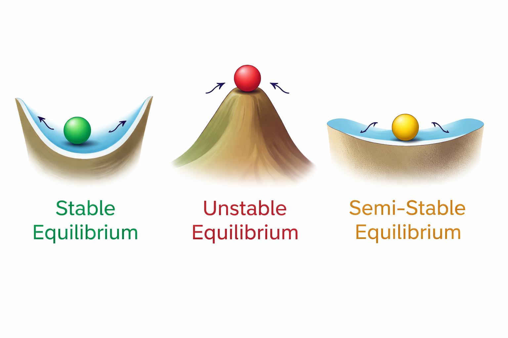

# Differential Equations: Modeling Change Over Time

Across QSci 291 and 292, calculus has really been about one thing: change.

**Derivatives** measure a *rate*: how fast something is changing right now. How fast is a population growing? How quickly is the water warming? How fast is a forest taking up carbon?

**Integrals** add up small changes over time or space. How much water went down the river this week? How much carbon did a wetland store over a decade?

A **differential equation** puts the two together. Instead of being handed a function to differentiate or integrate, you're told *how a quantity changes*, and your job is to work out the function itself. A derivative tells you the rate. An integral adds up the rate. A differential equation says how the rate depends on the state of the system.

---

## An Environmental Example: Lake Pollution

A lake contains a pollutant. Let \( P(t) \) be the mass of pollutant in the lake, in kilograms.

Suppose field data suggest that:

- The pollutant breaks down naturally.
- The rate of breakdown is proportional to how much pollutant is present.

That statement translates mathematically into:

\[
\frac{dP}{dt} = -kP
\]

This is a **relationship between the rate of change and the quantity itself**. You aren't given \( P(t) \). You're told how it changes. To find out what happens to the lake in the long run (does the pollution disappear, level off or build up?), you have to solve that relationship. That relationship is a **differential equation**.

Differential equations are how ecosystems, climate processes, chemical reactions and populations get modeled. Instead of analyzing change that already happened, you **build a model of how change works**.


```{r pollutant-decay-ics, echo=FALSE, warning=FALSE, message=FALSE, fig.alt="Four decay curves for dP/dt = -0.3P starting at 10, 25, 50 and 100 kg. All fall toward zero over 15 days."}
library(tidyverse)

# Decay constant
k <- 0.3

# Time sequence
t <- seq(0, 15, length.out = 400)

# Initial conditions
P0_values <- c(10, 25, 50, 100)

# Create data
df <- expand_grid(t = t, P0 = P0_values) |>
  mutate(P = P0 * exp(-k * t))

# Plot
ggplot(df, aes(x = t, y = P, color = factor(P0))) +
  geom_line(size = 1) +
  labs(
    x = "Time (days)",
    y = "Pollutant Amount (kg)",
    color = "Initial Amount (kg)",
    title = "Pollutant Decay for Different Initial Conditions",
    subtitle = expression(dP/dt == -k*P)
  ) +
  theme_minimal(base_size = 14) +
  xlim(0, 15)
```

## What Is a Differential Equation?

A **differential equation** is an equation that involves an unknown function and one or more of its derivatives. Unlike the equations you've solved before, the goal isn't a number. **The goal is a function.**

---

### What Makes an Equation “Differential”?

An equation is called *differential* if it contains:

- A derivative such as \( \frac{dy}{dt} \), \( y' \), or \( \frac{d^2y}{dx^2} \)
- An unknown function whose behavior we are trying to determine

For example:

\[
\frac{dP}{dt} = -kP
\]

This describes how \( P(t) \) changes over time. The derivative sits right in the equation. That's what makes it a differential equation.

---

### Important Terminology 

A few terms you'll need.

#### Ordinary Differential Equation (ODE) {-}

An equation involving derivatives with respect to **one independent variable** is called an **ordinary differential equation**.

Example:

\[
\frac{dP}{dt} = -kP
\]

Here, \(P\) depends only on \(t\), so this is an ODE.

If an equation involves **partial derivatives** with respect to multiple variables (for example, space and time), it is called a **partial differential equation (PDE)**.

---

#### Order of a Differential Equation {-}

The **order** is determined by the highest derivative that appears.

- If the highest derivative is \( \frac{dP}{dt} \), the equation is **first order**.
- If the highest derivative is \( \frac{d^2y}{dx^2} \), the equation is **second order**.

Example (first order):

\[
\frac{dP}{dt} = -kP
\]

Example (second order):

\[
\frac{d^2y}{dx^2} + y = 0
\]

In this course, we focus primarily on **first-order differential equations**.

---

#### Linear vs Nonlinear {-}

A differential equation is **linear** if:

- The dependent variable and its derivatives appear only to the first power.
- They are not multiplied together.

Example (linear):

\[
\frac{dP}{dt} = -kP
\]

Example (nonlinear):

\[
\frac{dP}{dt} = rP\left(1 - \frac{P}{K}\right)
\]

The logistic equation is nonlinear because, multiplied out, it contains a \(P^2\) term. Nonlinear equations can do more interesting things, which is often what you need for real environmental systems.

---

#### Solution of a Differential Equation {-}

Algebraic equations give you numbers. **Solutions to differential equations are functions.** You're not solving for one value of \(P\). You're solving for the whole function \(P(t)\). That shift is the biggest new idea in this chapter.


### How Is This Different from Other Equations?

Compare three kinds of equation.

#### Algebraic Equation {-}

\[
3x + 2 = 11
\]

We solve for a number. The answer is a specific value of \( x \).

---

#### Derivative Formula  {-}

\[
\frac{d}{dx}(x^2) = 2x
\]

You're given the function and asked for its derivative. The function is known.

---

#### Differential Equation {-}

\[
\frac{dy}{dt} = 2t
\]

Now the derivative is given and the function is unknown. You have to work out which function has this derivative. You're rebuilding a function from information about how it changes.

---

### Solutions Are Functions, Not Numbers

Consider:

\[
\frac{dP}{dt} = -kP
\]

A solution to this equation is:

\[
P(t) = P_0 e^{-kt}
\]

The solution is a **function of time**, and it depends on a constant \( P_0 \). There are infinitely many solutions, one for each starting value. Differential equations usually give you a *family* of solutions.

---

### Verifying a Solution

To check whether a function is a solution:

1. Compute its derivative.
2. Substitute both the function and its derivative into the equation.
3. Verify that both sides match.

Example:

Suppose we test:

\[
P(t) = P_0 e^{-kt}
\]

Compute the derivative:

\[
\frac{dP}{dt} = -kP_0 e^{-kt}
\]

Now notice that the derivative contains \(P(t)\) itself:

\[
\frac{dP}{dt} = -k (P_0 e^{-kt})
\]
\[
\frac{dP}{dt} = -k (P)
\]


\[
\frac{dP}{dt} = -kP
\]

That matches the original equation, so the function is a solution.

---

### How Do We Find the Solution?

So far, we have verified that  

\[
P(t) = P_0 e^{-kt}
\]

is a solution to  

\[
\frac{dP}{dt} = -kP.
\]

But how would you *find* that function in the first place?

This is a **separable** differential equation: you can rearrange it so all the \(P\) terms are on one side and all the \(t\) terms are on the other.

---

#### Step 1: Separate the Variables  {-}

Start with:

\[
\frac{dP}{dt} = -kP
\]

Rewrite the derivative as a fraction:

\[
\frac{1}{P} \frac{dP}{dt} = -k
\]

Now multiply both sides by \(dt\):

\[
\frac{1}{P} dP = -k \, dt
\]

The variables are now separated:

- Left side: only \(P\)
- Right side: only \(t\)

---

#### Step 2: Integrate Both Sides {-}

\[
\int \frac{1}{P} \, dP = \int -k \, dt
\]

Compute the integrals:

\[
\ln |P| = -kt + C
\]

---

#### Step 3: Solve for \(P(t)\) {-}

Exponentiate both sides to remove the logarithm:

\[
|P| = e^{-kt + C}
\]

Rewrite:

\[
|P| = e^C e^{-kt}
\]

Since \(e^C\) is just another constant, we rename it:

\[
P(t) = P_0 e^{-kt}
\]

where \(P_0\) represents the initial amount of pollutant.

---

#### Why This Works  {-}

You rearranged the equation so each variable had its own side, integrated to undo the derivative, and the constant of integration turned into the starting amount. **Separating the variables and integrating both sides** is the most useful technique in this chapter. It's the same two ideas as the rest of the course: derivatives describe rates, and integrals undo them.


### Separating the Variables

A differential equation doesn't hand you a function. It gives you a *rule for how the function changes*, and your job is to find the function that follows the rule.


### Concept Check: What Makes an Equation 'Differential' {-}

What distinguishes a *differential equation* from an algebraic equation or a derivative formula?

<details>
<summary><strong>Click to reveal answer</strong></summary>

A **differential equation** involves an unknown function *and its derivatives*.

- An **algebraic equation** (e.g., \(3x + 2 = 11\)) has an unknown *number*, and you solve for it.
- A **derivative formula** (e.g., \(\frac{d}{dt}(7e^{-0.3 t}) = -2.1 e^{-0.3 t}\)) tells you the derivative of a function you already know.
- A **differential equation** (e.g., \(\frac{dP}{dt} = -0.3 P\)) gives a *rule the derivative has to follow*, and the unknown is the whole function \(P(t)\).

</details>


### Concept Check: Why DE Solutions Are Functions, Not Numbers {-}

When you solve a differential equation, why is the answer a function rather than a single value?

<details>
<summary><strong>Click to reveal answer</strong></summary>

Because a differential equation describes **how a quantity changes**, not a condition at one point. The answer has to be the *whole function* that follows the rule at every time.

That's also why you need an **initial condition** (like "\(P(0) = 80\)") to pin down one solution. On its own, the equation usually has a *family* of solutions, one for each starting value.

</details>


---

## From Real-World Context to Differential Equation

Differential equations usually start as **sentences about how something changes**. Your job is to translate them into math.

---

### Translating Verbal Descriptions into Equations

Most environmental models start with a sentence like:

- "The population grows faster when it's larger."
- "The pollutant breaks down naturally over time."
- "Carbon uptake increases as the vegetation gets established."
- "The rate of warming depends on how far the temperature is from equilibrium."

Each one describes a **rate of change and what it depends on**. To translate:

1. Name the quantity that's changing.
2. Write its rate of change as a derivative.
3. Write down what that rate depends on.
4. Put them together.

---

### How Can a Rate Depend on Something?

A rate can depend on different things.

#### The Quantity Itself Example: Population growth {-}

If the rate of growth is proportional to the population size:

\[
\frac{dP}{dt} = rP
\]

Interpretation:

Bigger populations grow faster. Check the units: \(P\) is in individuals, so \(r\) must be in 1/time, which makes \(rP\) individuals/time, matching \(dP/dt\).

---

#### Time Example: Seasonal carbon uptake {-}

If uptake varies with time due to seasonality:

\[
\frac{dC}{dt} = 5 + 3\sin(t)
\]

Interpretation:

Here the uptake rate changes even if the system doesn't. Time itself (the season) drives the variation.

---

#### Other Variables Example: Temperature cooling toward equilibrium {-}

\[
\frac{dT}{dt} = -k(T - T_{\text{env}})
\]

Interpretation:

The rate depends on the gap between the current temperature and the surroundings. When \(T = T_{\text{env}}\), the rate is zero, which is where equilibrium comes from.

---

### Units Analysis in Differential Equations

Units are one of your best error checks.

Suppose:

- \(P\) is measured in kilograms.
- \(t\) is measured in days.

Then:

\[
\frac{dP}{dt}
\]

must have units kilograms/day.

If we write:

\[
\frac{dP}{dt} = -kP
\]

then:

- \(P\) has units kg
- So \(k\) must have units 1/day

#### What Does “per Day” Actually Mean? {-}

A unit like \(1/\text{day}\) ("per day") marks a **rate constant**: the *fraction of the current amount* that changes per day.

So if
\[
k = 0.25 \ \text{day}^{-1},
\]
that does **not** mean 0.25 kilograms per day. It means the pollutant is being lost at a rate of 25% of whatever is there right now, per day. (Because the amount shrinks as the day goes on, the actual loss over one full day is a bit less: about 22%, since \(e^{-0.25} \approx 0.78\).)

The rate scales with the amount. Double the amount and the daily loss doubles. That's what makes exponential models *proportional*.

---

### Environmental and Biological Rate Models

Some common patterns.

---

#### Population Growth  {-}

“If population growth is proportional to population size”:

\[
\frac{dP}{dt} = rP
\]

---

#### Pollutant Decay {-}

“If pollutant breakdown is proportional to how much pollutant is present”:

\[
\frac{dP}{dt} = -kP
\]

---

#### Carbon Sequestration {-}

“If uptake increases with biomass but levels off as storage capacity is approached”:

\[
\frac{dC}{dt} = rC\left(1 - \frac{C}{K}\right)
\]

This puts a limit on growth.

---

#### Temperature Adjustment {-}

“If temperature cools at a rate proportional to how far it is from equilibrium”:

\[
\frac{dT}{dt} = -k(T - T_{\text{env}})
\]

---

### Every Term Is an Assumption

Writing a differential equation is making a claim about how a system works. Every term means something, and every parameter has an interpretation. If you can't say what a term represents physically, it probably shouldn't be there.


### Concept Check: Translating 'Rate Is Proportional To' into a DE {-}

A biologist tells you that the rate of growth of a microbial population is proportional to the current population size. How do you write that statement as a differential equation, and what does the proportionality constant mean physically?

<details>
<summary><strong>Click to reveal answer</strong></summary>

If \(P(t)\) is the population size, the statement translates directly to
\[
\frac{dP}{dt} = k P,
\]
where \(k\) is the **per-capita growth rate**: how much each individual contributes to growth, in units of "per time." If \(k > 0\), the population grows exponentially. If \(k < 0\), it shrinks.

"Proportional to X" in words becomes "= k × X" in the equation.

</details>


### Concept Check: Why Units Matter in a Differential Equation {-}

Why is it important that every term in a differential equation have consistent units, and how does this help catch modeling errors?

<details>
<summary><strong>Click to reveal answer</strong></summary>

Every term has to have units of *rate of change of the quantity* (individuals per day, mg per second). If you write \(\frac{dP}{dt} = k P - 2\) for a population in individuals, then \(kP\) has to be individuals per day (so \(k\) is 1/day) *and* the 2 has to be individuals per day too. Each term has to be the same kind of thing.

If the units don't match across terms, **the model is wrong**: a constant is missing a scale factor, or you've mixed up a rate and an amount. It's one of the fastest ways to catch a modeling mistake.

</details>


---

## Slope Fields (Direction Fields)

So far you've solved differential equations with algebra. What if you can't, or you want to see what solutions do *before* solving? A **slope field** (or direction field) lets you see the behavior straight from the rate rule, with no formula.

---

### Constructing a Slope Field

Example:

\[
\frac{dP}{dt} = -kP
\]

The slope depends only on \(P\), not on \(t\). (\(k\) is just a constant.) So on a graph with \(P\) up the side and \(t\) along the bottom:

- along any horizontal line (constant \(P\)), the slope is the same
- above zero, the slopes are negative
- below zero, the slopes are positive
- at \(P = 0\), the slope is zero

To build the slope field:

1. Pick grid points in the \((t, P)\) plane.
2. Work out the slope at each point.
3. Draw a short line segment with that slope.

You haven't solved anything, and you can already see how the solutions behave.

---

### Interpreting Behavior from a Slope Field

From the slope field you can see whether solutions rise or fall, where the slopes are zero, where the equilibria are, and what happens in the long run. For
\[
\frac{dP}{dt} = -kP
\]
every solution heads toward \(P = 0\), so \(P = 0\) is a stable equilibrium. All without solving.

---

### Sketching Solution Curves

A solution curve is one whose tangent matches the slope field everywhere. Pick a starting point, follow the little line segments, and draw a smooth curve that stays tangent to them. Each starting point gives a different curve, so the slope field shows you the whole **family of solutions** at once.

---

### Stability and Long-Term Behavior

Slope fields make stability visible. If nearby solutions move toward an equilibrium, it's **stable**. If they move away, it's **unstable**. If they move toward it from one side and away on the other, it's **semi-stable**.

### Why This Matters

A lot of environmental models can't be solved exactly. They're nonlinear, they can have several equilibria, and they can have tipping points where a small change has big consequences. Often the goal isn't a formula. It's understanding where the system ends up and how it responds to a push, and slope fields show you that.


### Visualizing Differential Equations Without Solving Them

A differential equation of the form
\[
\frac{dP}{dt} = f(t, P)
\]
doesn't give you \( P(t) \). It gives you the **slope** of \( P(t) \) at every point \((t, P)\). At each point, plug in the coordinates, work out the slope and draw a short segment. The result is a field of segments that shows how solutions have to move.

---

#### Example: Building a Slope Field from Numbers {-}

Consider the differential equation

\[
\frac{dP}{dt} = -kP + 2.
\]

The slope depends only on \(P\), not directly on \(t\). Take

\[
k = 0.5.
\]

Then the equation becomes:

\[
\frac{dP}{dt} = -0.5P + 2.
\]

So at every point \((t, P)\), the slope is:

\[
f(t, P) = \frac{dP}{dt} = -0.5P + 2.
\]

---

#### Step 1: Compute Slopes at Specific Points {-}

Work out the slope at a few points.

At \((0, 0)\):

\[
f(0, 0) = \frac{dP}{dt} = -0.5(0) + 2 = 2.
\]

At \((2, 0)\):

\[
f(2, 0) = \frac{dP}{dt} = -0.5(0) + 2 = 2.
\]

At \((1, 2)\):

\[
f(1, 2) = \frac{dP}{dt} = -0.5(2) + 2 = 1.
\]

At \((3, 4)\):

\[
f(3, 4) = \frac{dP}{dt} = -0.5(4) + 2 = 0.
\]

At \((4, 6)\):

\[
f(4, 6) = \frac{dP}{dt} = -0.5(6) + 2 = -1.
\]


```{r slope-field-sample-points, echo=FALSE, warning=FALSE, message=FALSE, fig.alt="A few labeled grid points with short line segments showing the slope of dP/dt = -0.5P + 2 at each point."}
library(tidyverse)

# Differential equation: dP/dt = -kP + 2
k <- 0.5
f <- function(t, P) {
  -k * P + 2
}

# Given points (t, P)
points <- tibble(
  t = c(0, 2, 1, 3, 4),
  P = c(0, 0, 2, 4, 6)
) |>
  mutate(
    slope = f(t, P),
    # Create short line segments centered at each point
    dt = 0.4 / sqrt(1 + slope^2),
    dP = slope * dt,
    t0 = t - dt,
    t1 = t + dt,
    P0 = P - dP,
    P1 = P + dP
  )

# Plot
ggplot() +
  geom_segment(
    data = points,
    aes(x = t0, y = P0, xend = t1, yend = P1),
    linewidth = 1
  ) +
  geom_point(
    data = points,
    aes(x = t, y = P),
    size = 3
  ) +
  geom_text(
    data = points,
    aes(x = t, y = P, label = paste("s =", slope)),
    vjust = -1.2
  ) +
  coord_fixed(xlim = c(-1, 5), ylim = c(-1, 7)) +
  labs(
    x = "t",
    y = "P",
    title = expression(dP/dt == -0.5*P + 2),
    subtitle = "Slopes calculated at selected points"
  ) +
  theme_minimal(base_size = 14)
```


Fill the whole plane with these segments and you have guides for every possible solution. Any curve that follows them is one member of the family of solutions. There are infinitely many because integration produces a constant. Knowing the starting value picks out one.

You don't need to compute every point here. There's no \(t\) in the equation, so the slope is the same all the way along any horizontal line.

```{r slope-field-grid, echo=FALSE, warning=FALSE, message=FALSE, fig.alt="Slope field for dP/dt = -0.5P + 2 at integer grid points. Segments tilt up below P = 4, are flat at P = 4 and tilt down above it."}
library(tidyverse)
library(tidyverse)

# Differential equation: dP/dt = -kP + 2
k <- 0.5
f <- function(t, P) {
  -k * P + 2
}

# Integer grid over the plotting window
t_int <- -1:5
P_int <- -1:7

grid <- expand_grid(t = t_int, P = P_int) |>
  mutate(
    slope = f(t, P),
    # Short line segments centered at each grid point
    dt = 0.35 / sqrt(1 + slope^2),
    dP = slope * dt,
    t0 = t - dt,
    t1 = t + dt,
    P0 = P - dP,
    P1 = P + dP
  )

# Plot slope field
ggplot(grid) +
  geom_segment(aes(x = t0, y = P0, xend = t1, yend = P1),
               linewidth = 0.9) +
  coord_fixed(xlim = c(-1, 5), ylim = c(-1, 7)) +
  labs(
    x = "t",
    y = "P",
    title = expression(dP/dt == -0.5*P + 2),
    subtitle = "Slope field drawn at integer grid points"
  ) +
  theme_minimal(base_size = 14)
```

#### Step 2: Interpret the Behavior {-}

Since:

- Slopes are zero when \(P = 4\),
- Slopes are positive below \(4\),
- Slopes are negative above \(4\),

the line \(P = 4\) is an **equilibrium solution**.

A solution that starts below 4 rises toward 4. One that starts above 4 falls toward 4. One that starts at exactly 4 stays there. Solutions move toward \(P = 4\) from both sides, so it's **stable**. You can see it in the slope field: segments tilt up below 4 and down above it.

```{r slope-field-solutions, echo=FALSE, warning=FALSE, message=FALSE, fig.alt="Slope field for dP/dt = -0.5P + 2 with solution curves starting at 1, 2.5, 4, 5 and 6. Every curve approaches the dashed line P = 4."}
library(tidyverse)

# Differential equation: dP/dt = -kP + 2
k <- 0.5
f <- function(t, P) -k * P + 2

# ---------------------------------
# 1) Slope field (integer grid)
# ---------------------------------
t_int <- -1:5
P_int <- -1:7

field <- expand_grid(t = t_int, P = P_int) |>
  mutate(
    slope = f(t, P),
    dt = 0.35 / sqrt(1 + slope^2),
    dP = slope * dt,
    t0 = t - dt, t1 = t + dt,
    P0 = P - dP, P1 = P + dP
  )

# ---------------------------------
# 2) Trajectories from P(0) initial conditions
#    Solution: P(t) = 4 + (P0 - 4) e^{-kt}
#    (because equilibrium is P* = 2/k = 4)
# ---------------------------------
P0_vals <- c(6, 5, 4, 2.5, 1)
t_curve <- seq(-1, 5, length.out = 600)

traj <- expand_grid(t = t_curve, P0 = P0_vals) |>
  mutate(
    P = 4 + (P0 - 4) * exp(-k * t)
  ) |>
  filter(P >= -1, P <= 7)

# ---------------------------------
# Plot
# ---------------------------------
ggplot() +
  # light grey slope field in background
  geom_segment(
    data = field,
    aes(x = t0, y = P0, xend = t1, yend = P1),
    linewidth = 0.7,
    color = "grey80"
  ) +
  # equilibrium line at P = 4
  geom_hline(yintercept = 4, linetype = "dashed") +
  # colored trajectories
  geom_path(
    data = traj,
    aes(x = t, y = P, color = factor(P0)),
    linewidth = 1.2
  ) +
  coord_fixed(xlim = c(-1, 5), ylim = c(-1, 7)) +
  labs(
    x = "t",
    y = "P",
    color = "Initial Value P(0)",
    title = expression(dP/dt == -0.5*P + 2),
    subtitle = "Slope field (background) with trajectories approaching the stable equilibrium P = 4"
  ) +
  theme_minimal(base_size = 14)
```

Pick a starting point anywhere in the field and let the segments guide you. Think of the slope field as the currents on a big lake, and you're on a paddleboard. Wherever you start, the current carries you along a path. Start somewhere else and you get a different path.

So a slope field shows you equilibria, growth and decay, stability and the whole family of solutions, without a formula.

---

### Concept Check: What a Slope Field Shows That a Formula Doesn't {-}

What does a slope field reveal about a differential equation that you might not see by staring at the algebraic form alone?

<details>
<summary><strong>Click to reveal answer</strong></summary>

It shows you the **shape** of the solutions across the whole \((t, P)\) plane, without solving anything:

- where solutions flatten out (equilibria)
- whether different starting points come together or spread apart
- the long-run behavior (does \(P \to \infty\)? level off at \(K\)? oscillate?)
- where change is fast and where it's slow

For equations you *can't* solve exactly, a slope field is often the only practical way to see what the solutions look like.

</details>


### Concept Check: Sketching a Solution Curve from a Slope Field {-}

If you're given a slope field and a starting point \((t_0, P_0)\), how do you sketch the solution curve passing through that point?

<details>
<summary><strong>Click to reveal answer</strong></summary>

Put your pen at \((t_0, P_0)\) and **follow the segments**:

1. At your current point, the segment shows which way the solution heads.
2. Move a small step that way.
3. At the new point, check the segment again and adjust.
4. Repeat.

The curve you trace is the solution through \((t_0, P_0)\). (Euler's method does the same thing numerically.)

</details>


---

## Equilibrium Solutions and Stability

Differential equations also let you predict **long-term behavior**, often without solving them. The key ideas are **equilibrium** and **stability**: where does the system settle, what stays constant, and what happens if you give it a nudge?

---

### Constant (Steady-State) Solutions

An **equilibrium solution** (or steady state) is a value that doesn't change over time.

Mathematically, an equilibrium occurs when:

\[
\frac{dP}{dt} = 0.
\]

At equilibrium:

- The rate of change is zero.
- The system remains constant.
- The solution is a horizontal line.

For example, consider:

\[
\frac{dP}{dt} = rP\left(1 - \frac{P}{K}\right).
\]

Set the right-hand side equal to zero:

\[
rP\left(1 - \frac{P}{K}\right) = 0.
\]

Equilibria occur when:

\[
P = 0
\quad \text{or} \quad
P = K.
\]

These represent constant solutions:

\[
P(t) = 0
\quad \text{and} \quad
P(t) = K.
\]

They describe steady states of the system.

---

### Stable vs Unstable Equilibria

Not all equilibria behave the same. To tell them apart, nudge the system a little up or down and see whether it comes back:

- Nearby solutions move **toward** it: **stable**.
- Nearby solutions move **away**: **unstable**.
- Toward it on one side, away on the other: **semi-stable**.

For the logistic equation:

- If \(0 < P < K\), then \( \frac{dP}{dt} > 0 \).
- If \(P > K\), then \( \frac{dP}{dt} < 0 \).

So:

- \(P = 0\) is **unstable** (small populations grow away from zero).
- \(P = K\) is **stable** (populations move toward carrying capacity).

That gives you the long-term outcome without solving.

---

#### The Ball-and-Cup Analogy {-}

Picture a ball on a curved landscape.

- A ball at the **bottom of a bowl**, nudged, rolls back. That's a **stable** equilibrium.
- A ball on **top of a hill**, nudged, rolls away. That's **unstable**.
- A ball on a **ledge**, with a drop on one side and a slope back up on the other, comes back if you push it one way and rolls off if you push it the other. That's **semi-stable**.
  


{fig.cap="" fig.alt="A ball sitting at the bottom of a bowl, labeled stable, a ball balanced on top of a hill, labeled unstable, and a ball on a ledge, labeled semi-stable." style="display:block; width:650px; margin:10px auto;"}

In the logistic model:

- \(P = K\) is the bottom of the bowl: nearby populations move toward it.
- \(P = 0\) is the top of the hill: any small population grows away from extinction.

Stability is about **how a system responds to disturbance**. In environmental systems, disturbances happen: storms, droughts, harvesting, climate swings. Whether the system recovers or shifts to a new state depends on the stability of its equilibria. That's what resilience, collapse and tipping points are about.


```{r logistic-slope-field, echo=FALSE, warning=FALSE, message=FALSE, fig.alt="Slope field for logistic growth with r = 0.6 and K = 1000. Curves starting below 1000 rise in an S shape toward K, curves starting above 1000 fall toward K, and dashed lines mark the equilibria at 0 and 1000."}
library(tidyverse)

# Parameters
r <- 0.6
K <- 1000

# Logistic DE: dP/dt = r P (1 - P/K)
f <- function(t, P) r * P * (1 - P / K)

# --------------------------------
# 1) Direction field grid (dense)
# --------------------------------
t_grid <- seq(0, 10, length.out = 31)
P_grid <- seq(0, 1400, length.out = 31)

field <- expand_grid(t = t_grid, P = P_grid) |>
  mutate(
    slope = f(t, P),
    theta = atan(slope),          # convert slope to angle
    L = 5.0,                     # visual half-length of each segment
    dt = L * cos(theta),
    dP = L * sin(theta),
    t0 = t - dt, t1 = t + dt,
    P0 = P - dP, P1 = P + dP
  )

# --------------------------------
# 2) Trajectories (analytic solution)
# P(t) = K / (1 + ((K-P0)/P0) e^{-rt})
# --------------------------------
P0_vals <- c(50, 150, 900, 1100, 1300)
t_curve <- seq(0, 10, length.out = 800)

traj <- expand_grid(t = t_curve, P0 = P0_vals) |>
  mutate(P = K / (1 + ((K - P0) / P0) * exp(-r * t)))

# --------------------------------
# Plot
# --------------------------------
ggplot() +
  # Direction field in light grey (NOW visible)
  geom_segment(
    data = field,
    aes(x = t0, y = P0, xend = t1, yend = P1),
    color = "grey50",
    linewidth = 0.7,
    alpha = 0.8
  ) +
  # Equilibria
  geom_hline(yintercept = 0, linetype = "dashed", color = "red", linewidth = 1) +
  geom_hline(yintercept = K, linetype = "dashed", color = "darkgreen", linewidth = 1) +
  # Trajectories
  geom_path(
    data = traj,
    aes(x = t, y = P, color = factor(P0)),
    linewidth = 1.3
  ) +
  # Labels
  annotate("text", x = 6.7, y = 140, label = "Unstable\nP = 0", color = "red", size = 5) +
  annotate("text", x = 6.7, y = K + 140, label = "Stable\nP = K", color = "darkgreen", size = 5) +
  coord_cartesian(xlim = c(0, 10), ylim = c(0, 1400)) +
  labs(
    x = "t",
    y = "P",
    color = "Initial P(0)",
    title = "Logistic Growth: Slope Field and Stability",
    subtitle = expression(dP/dt == r*P*(1 - P/K))
  ) +
  theme_minimal(base_size = 14)
```


---


### Long-Term Predictions

Equilibrium analysis allows us to predict behavior as: \[
t \to \infty.
\]

For logistic growth:

\[
\lim_{t \to \infty} P(t) = K
\quad \text{(if } P_0 > 0\text{)}.
\]

The system naturally approaches carrying capacity.

For exponential decay:

\[
\lim_{t \to \infty} P(t) = 0.
\]

The system approaches extinction or disappearance.

You don't need to solve anything in detail for these. They come straight from the structure of the equation.

---

### Why This Matters

In environmental work you often care less about exact formulas than about questions like: will the system stabilize? Will it collapse? Is there a tipping point? Equilibrium and stability analysis answer those. They turn calculus from computing into interpreting: understanding where a system is headed.

---

### Concept Check: Finding Equilibrium Solutions Algebraically {-}

What's an equilibrium solution to a differential equation, and how do you find one algebraically?

<details>
<summary><strong>Click to reveal answer</strong></summary>

An **equilibrium** is a constant value \(P^*\) where the system stays once it gets there. Mathematically, it's a value where \(\frac{dP}{dt} = 0\).

For an equation \(\frac{dP}{dt} = f(P)\), **set the right-hand side to zero and solve for \(P\)**.

For example, the logistic equation \(\frac{dP}{dt} = rP(1 - P/K)\) is zero when \(P = 0\) or \(P = K\). Those are its two equilibria.

</details>


### Concept Check: Stable vs Unstable Equilibria {-}

What's the difference between a *stable* and an *unstable* equilibrium, and how do you tell which is which?

<details>
<summary><strong>Click to reveal answer</strong></summary>

**Stable:** small disturbances *die away* and the system comes back. Like a ball at the bottom of a cup.

**Unstable:** small disturbances *grow* and the system runs away. Like a ball on top of a hill.

**How to tell:** look at the sign of \(\frac{dP}{dt}\) just below and just above the equilibrium.

- Both point *toward* it: stable.
- Both point *away*: unstable.
- One toward, one away: semi-stable.

For logistic growth, \(P = K\) is stable (the population returns to carrying capacity after a disturbance) and \(P = 0\) is unstable (any small population grows away from zero).

</details>


---

## Separable Differential Equations

You've seen how to read solutions from a slope field. Now let's solve them algebraically. A **separable** differential equation is one you can rearrange so that everything involving the dependent variable is on one side and everything involving the independent variable is on the other. Then you can integrate both sides.

---

### Recognizing Separable Structure

A first-order differential equation is separable if it can be written in the form:

\[
\frac{dy}{dt} = g(t)\,h(y)
\]

The right-hand side is a function of time only times a function of the dependent variable only. If you can factor it like that, you can separate it.

---

### Algebraic Separation of Variables

Suppose:

\[
\frac{dy}{dt} = g(t)\,h(y)
\]

Rewrite it by dividing by \(h(y)\) and multiplying by \(dt\):

\[
\frac{1}{h(y)}\,dy = g(t)\,dt
\]

Now the left side has only \(y\) and the right side has only \(t\).

---

### Integrating Both Sides

Once separated, integrate:

\[
\int \frac{1}{h(y)}\,dy = \int g(t)\,dt
\]

Each side is an antiderivative, so all the techniques from Chapter 5 apply.

---

### Solving for an Explicit Solution

Then add a constant of integration, rearrange, and solve for the dependent variable if you can. Sometimes you get an explicit \(y(t)\). Sometimes you leave it in implicit form. Either way, you've rebuilt the function from its rate rule.

---

### Initial Value Problems (IVPs)

On its own, a differential equation gives a **family of solutions**. To pick out one, you need an **initial condition**:

\[
y(t_0) = y_0
\]

This allows us to determine the constant of integration.

Example:

\[
\frac{dP}{dt} = -kP
\]

After separation and integration:

\[
P(t) = Ce^{-kt}
\]

Apply \(P(0) = P_0\):

\[
P_0 = C
\]

So the specific solution becomes:

\[
P(t) = P_0 e^{-kt}
\]

The starting value picks the curve.

---

### Worked Numerical Example: Separable Differential Equation (with an IVP)

Suppose a contaminant in a pond breaks down naturally at a rate proportional to the amount present:

\[
\frac{dP}{dt} = -0.3P,
\]

where:

- \(P(t)\) = pollutant mass (kg)
- \(t\) = time (days)
- \(0.3\ \text{day}^{-1}\) is the decay constant

Assume the pond initially contains:

\[
P(0) = 80 \text{ kg}.
\]

Solve for \(P(t)\) step by step.

---

#### Recognizing Separable Structure {-}

It's separable if it can be written as

\[
\frac{dP}{dt} = g(t)\,h(P).
\]

Here:

\[
\frac{dP}{dt} = -0.3P
\]

can be written as:

with \(g(t) = -0.3\) (a function of time only, here a constant) and \(h(P) = P\). So it's separable.

---

#### Algebraic Separation of Variables {-}

Start with:

\[
\frac{dP}{dt} = -0.3P
\]

Divide both sides by \(P\) (assuming \(P \neq 0\)) and multiply by \(dt\):

\[
\frac{1}{P}\,dP = -0.3\,dt
\]

Now the variables are separated.

---

### Integrating Both Sides

Integrate both sides:

\[
\int \frac{1}{P}\,dP = \int -0.3\,dt
\]

Compute the integrals:

\[
\ln|P| = -0.3t + C
\]

---

#### Solving for an Explicit Solution {-}

Exponentiate both sides:

\[
|P| = e^{-0.3t + C}
\]

Rewrite:

\[
|P| = e^C e^{-0.3t}
\]

Let \(A = e^C\), which is still just a constant. Since \(P(t)\) is a mass, it can't be negative, so

\[
P(t) = A e^{-0.3t}
\]

---

#### Initial Value Problem (IVP) {-}

Use the initial condition \(P(0) = 80\):

\[
80 = A e^{-0.3(0)} = A
\]

So \(A = 80\), and the specific solution is:

\[
P(t) = 80e^{-0.3t}
\]

---

#### Quick Numerical Check {-}

- After 5 days:
  \[
  P(5) = 80e^{-1.5} \approx 80(0.223) \approx 17.9 \text{ kg}
  \]

That's the expected shape: fast decay early, slowing as \(P\) gets close to zero.

---

### Applications of Separable Equations

Separable equations show up all over environmental and biological modeling.

---

#### Exponential Growth and Decay {-}

If growth is proportional to population size:

\[
\frac{dP}{dt} = rP
\]

Solution:

\[
P(t) = P_0 e^{rt}
\]

If decay is proportional to amount present:

\[
\frac{dP}{dt} = -kP
\]

Solution:

\[
P(t) = P_0 e^{-kt}
\]

That covers population growth, contaminant decay and carbon loss (and compound interest).

---

#### Radioactive Decay {-}

If a radioactive substance decays proportionally to the amount remaining:

\[
\frac{dN}{dt} = -\lambda N
\]

Solution:

\[
N(t) = N_0 e^{-\lambda t}
\]

From this you get the half-life, the long-term decay, and how long it takes to reach a safe level.

---

#### Logistic Population Models 

When growth slows as a system approaches a maximum capacity, we use the **logistic model**:

\[
\frac{dP}{dt} = rP\left(1 - \frac{P}{K}\right)
\]

where:

- \(P(t)\) = population size  
- \(r\) = intrinsic growth rate  
- \(K\) = carrying capacity  

This adds a carrying capacity \(K\): growth depends on how crowded the population is, and it levels off.

---

#### Step 1: Separate the Variables {-}

Rewrite:

\[
\frac{dP}{dt}
=
rP\left(\frac{K-P}{K}\right)
=
\frac{r}{K} P(K-P).
\]

Separate variables:

\[
\frac{dP}{P(K-P)} = \frac{r}{K} dt.
\]

---

#### Step 2: Use Partial Fractions {-}

We decompose:

\[
\frac{1}{P(K-P)}
=
\frac{1}{K}
\left(
\frac{1}{P}
+
\frac{1}{K-P}
\right).
\]

Substitute:

\[
\frac{1}{K}
\left(
\frac{1}{P}
+
\frac{1}{K-P}
\right)
dP
=
\frac{r}{K} dt.
\]

Multiply both sides by \(K\):

\[
\left(
\frac{1}{P}
+
\frac{1}{K-P}
\right)
dP
=
r\, dt.
\]

---

#### Step 3: Integrate Both Sides  {-}

\[
\int
\left(
\frac{1}{P}
+
\frac{1}{K-P}
\right)
dP
=
\int r\, dt.
\]

Compute the integrals:

\[
\ln|P| - \ln|K-P|
=
rt + C.
\]

Combine logarithms:

\[
\ln\left|
\frac{P}{K-P}
\right|
=
rt + C.
\]

---

#### Step 4: Solve for \(P(t)\) {-}

Exponentiate:

\[
\frac{P}{K-P}
=
Ae^{rt}.
\]

Solve algebraically:

\[
P = (K-P)Ae^{rt}
\]

\[
P = K Ae^{rt} - P Ae^{rt}
\]

\[
P(1 + Ae^{rt}) = K Ae^{rt}
\]

\[
P(t)
=
\frac{K Ae^{rt}}{1 + Ae^{rt}}.
\]

Rewrite in standard form:

\[
\boxed{
P(t)
=
\frac{K}{1 + Be^{-rt}}
}
\]

where \(B\) is a constant determined by the initial condition.

---

#### Step 5: Apply an Initial Condition  {-}

If \(P(0) = P_0\), then

\[
B = \frac{K - P_0}{P_0}.
\]

So the full solution becomes:

\[
\boxed{
P(t)
=
\frac{K}
{1 + \left(\frac{K - P_0}{P_0}\right)e^{-rt}}
}
\]

---

#### What This Model Captures  {-}

The logistic solution shows that:

- early growth is close to exponential
- growth slows as \(P\) gets close to \(K\)
- \(P = K\) is a **stable equilibrium**
- the curve is S-shaped
- the growth rate is fastest at \(P = \frac{K}{2}\)

Unlike exponential growth, it builds in limits: resources, competition, self-regulation.


### Why Separable Equations Work

You rearrange the rate rule, integrate to undo the derivative, and use the starting value to pick one solution. It's the first kind of differential equation you can solve systematically, and a lot of environmental models are this kind.


### Concept Check: Recognizing a Separable Differential Equation {-}

How do you recognize whether a differential equation is *separable*, and why does separability matter?

<details>
<summary><strong>Click to reveal answer</strong></summary>

A first-order DE is **separable** if you can rewrite it as
\[
\frac{dy}{dx} = g(x) \cdot h(y),
\]
i.e., the right-hand side **factors** into a function of \(x\) times a function of \(y\). Once you have that, you can move all \(y\) terms to one side and all \(x\) terms to the other:
\[
\frac{dy}{h(y)} = g(x)\,dx,
\]
and integrate both sides directly. 

Most of the standard environmental models (exponential growth and decay, Newton's cooling, logistic growth) are separable. That matters because you get an *explicit* solution instead of only a numerical approximation, so you can see how each parameter shapes the answer.

</details>


### Concept Check: What an Initial Value Problem Adds {-}

When you solve a separable differential equation, you get a family of solutions involving an unknown constant. What does an *initial condition* ("initial value problem") add, and why is the resulting solution unique?

<details>
<summary><strong>Click to reveal answer</strong></summary>

The general solution has an arbitrary constant \(C\). Every value of \(C\) gives a valid solution, so there's an infinite *family*, each starting somewhere different.

An **initial condition** like \(P(0) = P_0\) picks the *one* solution through that starting point. Plug in \(t = 0\) and \(P = P_0\) and solve for \(C\). The result, an **initial value problem (IVP)**, has exactly one solution.

That matches reality: a lake with 80 mg/L of pollutant at noon follows *one* concentration curve over the next week, not a family of them.

</details>


---

## Exponential Growth and Decay

Exponential models come from a **rate of change proportional to the current amount**.

\[
\frac{dP}{dt} = rP
\quad \text{(growth)}
\]

\[
\frac{dP}{dt} = -kP
\quad \text{(decay)}
\]

These equations lead to solutions of the form:

\[
P(t) = P_0 e^{rt}
\quad \text{or} \quad
P(t) = P_0 e^{-kt}.
\]

The defining feature: the bigger the quantity, the faster it changes.

---

### Why Exponential Behavior Matters in the Environment

Exponential change shows up wherever there's feedback:

- early growth of an invasive species
- the early spread of an infectious disease
- algal blooms in nutrient-rich water
- radioactive decay
- the breakdown of contaminants

Growth speeds up because each new unit adds to further growth, so small proportional rates add up to big long-term changes. Doubling time and half-life give you an intuitive sense of how fast. Exponential models usually describe the **early** behavior of a system, before limits kick in.

---

### Constant Proportional Growth

Suppose an invasive fish population grows at a rate proportional to its size:

\[
\frac{dP}{dt} = 0.4P
\]

Let:

- \(P_0 = 200\) fish  
- \(r = 0.4 \text{ yr}^{-1}\)

The solution is:

\[
P(t) = 200e^{0.4t}.
\]

After 3 years:

\[
P(3) = 200e^{1.2} \approx 200(3.32) \approx 664
\]

After 6 years:

\[
P(6) = 200e^{2.4} \approx 200(11.02) \approx 2204
\]


```{r exp-growth-points, echo=FALSE, warning=FALSE, message=FALSE, fig.alt="Exponential growth curve P = 200e^{0.4t}, with points marked at t = 0, 3 and 6 years showing the population rising faster and faster."}
library(tidyverse)

# Parameters
P0 <- 200
r  <- 0.4

# Time sequence
t <- seq(0, 6.5, length.out = 500)

# Exponential model
P <- P0 * exp(r * t)

df <- tibble(t = t, P = P)

# Key points
points_df <- tibble(
  t = c(0, 3, 6),
  P = P0 * exp(r * c(0, 3, 6))
)

# Plot
ggplot(df, aes(x = t, y = P)) +
  geom_line(linewidth = 1.2) +
  geom_point(data = points_df, size = 3) +
  geom_segment(data = points_df,
               aes(x = t, xend = t, y = 0, yend = P),
               linetype = "dashed") +
  geom_segment(data = points_df,
               aes(x = 0, xend = t, y = P, yend = P),
               linetype = "dashed") +
  geom_text(data = points_df,
            aes(label = paste0("(", t, ", ", round(P), ")")),
            vjust = -1.2) +
  annotate("text", x = 4.5, y = 1800,
           label = "Growth accelerates\nas population increases",
           size = 5) +
  labs(
    x = "Time (years)",
    y = "Population Size (fish)",
    title = expression(dP/dt == 0.4*P),
    subtitle = expression(P(t) == 200*e^{0.4*t})
  ) +
  theme_minimal(base_size = 14) +
  coord_cartesian(xlim = c(0, 6.5), ylim = c(0, 2400))
```


#### Interpretation {-}

The population grows slowly at first, then faster and faster. Nothing in the model stops it, so it's only realistic early in an invasion.

---

### Doubling Time

The **doubling time** is the time required for a quantity to double.

Set:

\[
2P_0 = P_0 e^{rt}
\]

Cancel \(P_0\):

\[
2 = e^{rt}
\]

Take natural logarithms:

\[
\ln 2 = rt
\]

\[
t = \frac{\ln 2}{r}
\]

For \(r = 0.4\):

\[
t = \frac{0.693}{0.4} \approx 1.73 \text{ years}
\]

```{r doubling-time, echo=FALSE, warning=FALSE, message=FALSE, fig.alt="Exponential growth from 200, with dashed lines marking the doubling time where the curve reaches 400."}
library(tidyverse)

# Parameters
P0 <- 200
r  <- 0.4

# Doubling time
t_double <- log(2) / r

# Time sequence
t <- seq(0, 4, length.out = 500)

# Model
P <- P0 * exp(r * t)

df <- tibble(t = t, P = P)

# Key doubling points
double_df <- tibble(
  t = c(0, t_double),
  P = c(P0, 2 * P0)
)

# Plot
ggplot(df, aes(x = t, y = P)) +
  geom_line(color = "steelblue", linewidth = 1.2) +
  
  # Highlight doubling time
  geom_vline(xintercept = t_double, linetype = "dashed", color = "darkred") +
  geom_hline(yintercept = 2 * P0, linetype = "dashed", color = "darkgreen") +
  
  # Points at P0 and 2P0
  geom_point(data = double_df, aes(x = t, y = P),
             size = 3, color = "black") +
  
  geom_text(data = double_df,
            aes(label = paste0("(", round(t,2), ", ", round(P), ")")),
            vjust = -1.2) +
  
  annotate("text",
           x = t_double + 0.3,
           y = 2 * P0 + 80,
           label = paste("Doubling time ≈", round(t_double,2), "years"),
           color = "darkred",
           size = 5) +
  
  labs(
    x = "Time (years)",
    y = "Population Size",
    title = "Doubling Time in Exponential Growth",
    subtitle = expression(P(t) == 200*e^{0.4*t})
  ) +
  theme_minimal(base_size = 14) +
  coord_cartesian(xlim = c(0, 4), ylim = c(0, 1000))
```


#### Interpretation {-}

The population doubles every 1.73 years, regardless of starting size.

---

### Constant Proportional Decay

Suppose a pesticide in soil decays proportionally to the amount present:

\[
\frac{dP}{dt} = -0.25P
\]

Let:

- \(P_0 = 50\) kg  
- \(k = 0.25 \text{ yr}^{-1}\)

The solution is:

\[
P(t) = 50e^{-0.25t}.
\]

After 4 years:

\[
P(4) = 50e^{-1} \approx 50(0.368) \approx 18.4
\]

After 8 years:

\[
P(8) = 50e^{-2} \approx 50(0.135) \approx 6.75
\]

```{r exp-decay-points, echo=FALSE, warning=FALSE, message=FALSE, fig.alt="Exponential decay of a pollutant from 50 kg with k = 0.25 per year, with points marked at 0, 4 and 8 years."}
library(tidyverse)

# Parameters
P0 <- 50
k  <- 0.25

# Time sequence
t <- seq(0, 10, length.out = 500)

# Decay model
P <- P0 * exp(-k * t)

df <- tibble(t = t, P = P)

# Key points
points_df <- tibble(
  t = c(0, 4, 8),
  P = P0 * exp(-k * c(0, 4, 8))
)

# Plot
ggplot(df, aes(x = t, y = P)) +
  geom_line(color = "darkgreen", linewidth = 1.2) +
  
  # Highlight key times
  geom_vline(data = points_df,
             aes(xintercept = t),
             linetype = "dashed",
             color = "grey50") +
  
  geom_hline(data = points_df[-1,],
             aes(yintercept = P),
             linetype = "dashed",
             color = "grey50") +
  
  geom_point(data = points_df,
             aes(x = t, y = P),
             size = 3,
             color = "black") +
  
  geom_text(data = points_df,
            aes(label = paste0("(", t, ", ", round(P,1), ")")),
            vjust = -1.2) +
  
  annotate("text",
           x = 6.5,
           y = 35,
           label = "Rapid decline at first,\nthen slowing toward zero",
           color = "darkgreen",
           size = 5) +
  
  labs(
    x = "Time (years)",
    y = "Pollutant Mass (kg)",
    title = expression(dP/dt == -0.25*P),
    subtitle = expression(P(t) == 50*e^{-0.25*t})
  ) +
  theme_minimal(base_size = 14) +
  coord_cartesian(xlim = c(0, 10), ylim = c(0, 55))
```


---

### Half-Life

The **half-life** is the time required for a quantity to decrease to half its value.

Set:

\[
\frac{1}{2}P_0 = P_0 e^{-kt}
\]

Cancel \(P_0\):

\[
\frac{1}{2} = e^{-kt}
\]

Take logs:

\[
\ln\left(\frac{1}{2}\right) = -kt
\]

\[
t = \frac{\ln 2}{k}
\]

For \(k = 0.25\):

\[
t = \frac{0.693}{0.25} \approx 2.77 \text{ years}
\]

```{r half-life, echo=FALSE, warning=FALSE, message=FALSE, fig.alt="Exponential decay from 50 kg with dashed lines marking the half-life, where the curve reaches 25 kg at about 2.8 years."}
library(tidyverse)

# Parameters
P0 <- 50
k  <- 0.25

# Half-life
t_half <- log(2) / k

# Time sequence
t <- seq(0, 8, length.out = 500)

# Decay model
P <- P0 * exp(-k * t)

df <- tibble(t = t, P = P)

# Key half-life points
half_df <- tibble(
  t = c(0, t_half),
  P = c(P0, P0/2)
)

# Plot
ggplot(df, aes(x = t, y = P)) +
  geom_line(color = "darkgreen", linewidth = 1.2) +
  
  # Highlight half-life
  geom_vline(xintercept = t_half, linetype = "dashed", color = "darkred") +
  geom_hline(yintercept = P0/2, linetype = "dashed", color = "darkblue") +
  
  # Points
  geom_point(data = half_df, size = 3, color = "black") +
  
  geom_text(data = half_df,
            aes(label = paste0("(", round(t,2), ", ", round(P,1), ")")),
            vjust = -1.2) +
  
  annotate("text",
           x = t_half + 0.3,
           y = P0/2 + 5,
           label = paste("Half-life ≈", round(t_half,2), "years"),
           color = "darkred",
           size = 5) +
  
  annotate("text",
           x = 5,
           y = 40,
           label = "Every 2.77 years,\nthe amount halves",
           color = "darkgreen",
           size = 5) +
  
  labs(
    x = "Time (years)",
    y = "Pollutant Mass (kg)",
    title = expression(dP/dt == -0.25*P),
    subtitle = expression(P(t) == 50*e^{-0.25*t})
  ) +
  theme_minimal(base_size = 14) +
  coord_cartesian(xlim = c(0, 8), ylim = c(0, 55))
```


#### Interpretation {-}

The pollutant decreases by half every 2.77 years, regardless of how much is present.

---

### Continuous Growth in CO₂ Concentration

Atmospheric CO₂ has recently been rising by roughly 2.5 ppm a year, about 0.6% of its current level. Model that as proportional growth:

\[
\frac{dC}{dt} = 0.006C
\]

If the current concentration is \(420\) ppm:

\[
C(t) = 420e^{0.006t}
\]

After 20 years:

\[
C(20) = 420e^{0.12} \approx 420(1.127) \approx 474 \text{ ppm}
\]

A small proportional rate still adds up: about 54 ppm in 20 years, if the rate holds.

```{r co2-growth, echo=FALSE, warning=FALSE, message=FALSE, fig.alt="CO2 concentration rising from 420 ppm under 0.6% per year growth, with dashed lines marking about 474 ppm at year 20."}
library(tidyverse)

# Parameters
C0 <- 420        # current ppm
r  <- 0.006      # 0.6% per year

# Time sequence
t <- seq(0, 40, length.out = 600)

# Growth model
C <- C0 * exp(r * t)

df <- tibble(t = t, C = C)

# Key point at 20 years
point_df <- tibble(
  t = c(0, 20),
  C = C0 * exp(r * c(0, 20))
)

# Plot
ggplot(df, aes(x = t, y = C)) +
  geom_line(color = "firebrick", linewidth = 1.2) +
  
  # Mark 20-year point
  geom_vline(xintercept = 20, linetype = "dashed", color = "grey50") +
  geom_hline(yintercept = point_df$C[2], linetype = "dashed", color = "grey50") +
  
  geom_point(data = point_df,
             aes(x = t, y = C),
             size = 3,
             color = "black") +
  
  geom_text(data = point_df,
            aes(label = paste0("(", t, ", ", round(C), " ppm)")),
            vjust = -1.2) +
  
  annotate("text",
           x = 25,
           y = 520,
           label = "Small annual growth\ncompounds over time",
           color = "firebrick",
           size = 5) +
  
  labs(
    x = "Time (years)",
    y = "CO\u2082 Concentration (ppm)",
    title = expression(dC/dt == 0.006*C),
    subtitle = expression(C(t) == 420*e^{0.006*t})
  ) +
  theme_minimal(base_size = 14) +
  coord_cartesian(xlim = c(0, 40), ylim = c(400, 700))
```


---

### What Exponential Models Capture

Exponential models fit systems where change feeds on itself at a constant proportional rate, with nothing limiting it: early population growth, contaminant decay, radioactive processes. Real ecosystems can't grow exponentially forever, though, and that's what logistic growth fixes.


### Concept Check: When Exponential Is the Right Model {-}

Under what conditions is an exponential growth or decay model \(\frac{dP}{dt} = kP\) a good description of a real environmental process?

<details>
<summary><strong>Click to reveal answer</strong></summary>

When the **per-capita rate** (per individual, per unit of mass) stays roughly **constant** over the time you care about. That's reasonable when:

- **resources are plentiful**, so individuals don't slow each other down (early population growth, a freshly started bacterial culture)
- **first-order kinetics** apply (radioactive decay, simple pollutant breakdown, a drug clearing from the body)
- **the driving force is proportional to the current state** (Newton's cooling, once you subtract the surrounding temperature)

They *break down* once feedback kicks in: limited resources, used-up reactants, saturation. That's where logistic and other modified models come in.

</details>


### Concept Check: Doubling Time and the Rate Constant {-}

For an exponential growth process with rate constant \(k\), why does the doubling time depend only on \(k\) and not on the initial population?

<details>
<summary><strong>Click to reveal answer</strong></summary>

If \(P(t) = P_0 e^{kt}\), then setting \(P(t_d) = 2 P_0\) gives
\[
2 P_0 = P_0 e^{k t_d} \implies e^{k t_d} = 2 \implies t_d = \frac{\ln 2}{k}.
\]

\(P_0\) **cancels**, so the doubling time depends only on \(k\).

That's what makes exponential growth exponential: *whatever doubles in time \(t_d\) doubles again in the next \(t_d\), however big it's got*. The same logic gives the half-life for decay: \(t_{1/2} = \ln 2 / |k|\).

</details>


---

## Logistic Growth and Carrying Capacity

Exponential growth assumes no limits. Real systems have them. As a population grows, individuals compete for food, space and nutrients, and growth slows. The **logistic model** builds that in by multiplying exponential growth by a crowding factor:

\[
\frac{dP}{dt} = rP\left(1 - \frac{P}{K}\right)
\]

where:

- \(P(t)\) = population size  
- \(r\) = intrinsic growth rate  
- \(K\) = carrying capacity  

The factor \( \left(1 - \frac{P}{K} \right) \) slows growth as the population approaches its limit.

---

#### Limits to Growth {-}

The logistic equation slows itself down as the population grows.

The term

\[
\left(1 - \frac{P}{K}\right)
\]

acts as a limiting factor.

- When \(P\) is very small compared to \(K\),  
  \[
  1 - \frac{P}{K} \approx 1
  \]
  and growth behaves almost exactly like exponential growth.

- When \(P\) approaches \(K\),  
  \[
  1 - \frac{P}{K} \approx 0
  \]
  and growth slows dramatically.

- When \(P = K\),  
  \[
  \frac{dP}{dt} = 0
  \]
  and the population stabilizes.

One extra factor turns unlimited growth into self-limiting growth.

---

#### Modeling Resource Constraints {-}

The assumption is simple: growth is proportional to population size, and reduced in proportion to crowding. The fraction
\[
\frac{P}{K}
\]
is how much of the environment's capacity is in use. When it's small, there's room to spare. When it's close to 1, the system is crowded and growth stalls. That's how the model represents competition for food, habitat filling up and nutrient limits.

---

#### Equilibria {-}

Equilibria occur where the rate of change is zero:

\[
\frac{dP}{dt} = 0.
\]

For the logistic equation:

\[
\frac{dP}{dt} = rP\left(1 - \frac{P}{K}\right) = 0.
\]

This happens when either factor equals zero:

\[
P = 0
\quad \text{or} \quad
P = K.
\]

So there are two equilibrium solutions:

- \(P = 0\)
- \(P = K\)

These are the two possible long-term outcomes: extinction, or a population holding steady at capacity.

---

#### Stability of Equilibrium Solutions {-}

Check what happens near each one.

- If \(0 < P < K\), then \( \frac{dP}{dt} > 0 \).  
- If \(P > K\), then \( \frac{dP}{dt} < 0 \).

This means:

- If the population is slightly above zero, it grows away from zero.  
  So \(P = 0\) is **unstable**.

- If the population is slightly below \(K\), it increases toward \(K\).  
- If it is slightly above \(K\), it decreases toward \(K\).

So \(P = K\) is **stable**.

Populations move toward carrying capacity.

---

#### Inflection Point and Maximum Growth Rate {-}

The logistic curve is S-shaped, with three phases:

1. **Early:** close to exponential.
2. **Middle:** growing fastest.
3. **Late:** slowing as it approaches \(K\).

The population grows fastest when:

\[
P = \frac{K}{2}.
\]

At that point the curve changes from concave up to concave down, and the slope is at its largest. This is the **inflection point**, where growth switches from speeding up to slowing down.

---

#### Applications {-}

The logistic model shows up all over environmental science, because it has both growth and limits in it.

#### Fisheries {-}

Suppose a fish population in a lake follows logistic growth:

\[
\frac{dP}{dt} = rP\left(1 - \frac{P}{K}\right),
\]

where:

- \(P(t)\) = fish population (number of fish)
- \(r = 0.6 \ \text{yr}^{-1}\) (intrinsic growth rate)
- \(K = 10{,}000\) fish (carrying capacity)

Now suppose fishing removes a constant \(H\) fish per year. A simple harvest model is:

\[
\frac{dP}{dt} = rP\left(1 - \frac{P}{K}\right) - H.
\]

---

### Example: Moderate Harvest (Sustainable, Above a Threshold)

Let \(H = 1{,}000\) fish/year and suppose the population starts at:

\[
P(0) = 2{,}000.
\]

First, compute the natural growth rate at \(P=2{,}000\):

\[
rP\left(1 - \frac{P}{K}\right)
= 0.6(2000)\left(1 - \frac{2000}{10000}\right)
\]

\[
= 0.6(2000)(0.8) = 960 \ \text{fish/year}.
\]

Net change:

\[
\frac{dP}{dt} \approx 960 - 1000 = -40 \ \text{fish/year}.
\]

At this population size, harvesting removes more than the population replaces, so the population shrinks. And as it shrinks, natural growth drops further below 1,000, so the decline doesn't stop.

Now check growth at \(P = 4{,}000\):

\[
0.6(4000)\left(1 - \frac{4000}{10000}\right)
= 0.6(4000)(0.6) = 1440.
\]

Net change:

\[
\frac{dP}{dt} \approx 1440 - 1000 = +440.
\]

At \(P=4{,}000\), growth beats harvest, so the population increases.

So the starting point matters. Setting growth equal to harvest,
\[
0.6P\left(1 - \frac{P}{10000}\right) = 1000,
\]
gives two equilibria: \(P \approx 2{,}113\) and \(P \approx 7{,}887\). The slope field below shows a **stable** equilibrium near 7,900 and an **unstable** threshold near 2,100. Start above the threshold and the population settles near 7,900. Start below it, as at 2,000, and the population collapses even though the harvest is "moderate.\"

```{r harvest-moderate, echo=FALSE, warning=FALSE, message=FALSE, fig.alt="Slope field for logistic growth with K = 10,000 and a harvest of 1,000 fish per year. Curves starting above about 2,100 settle near 7,900, and curves starting below it fall to zero."}
library(tidyverse)

# Parameters
r <- 0.6
K <- 10000
H <- 1000

# Differential equation with harvest
f <- function(t, P) r * P * (1 - P / K) - H

# --------------------------------
# 1) Direction field (slope field)
# --------------------------------
t_grid <- seq(0, 15, length.out = 15)
P_grid <- seq(0, 12000, length.out = 15)

field <- expand_grid(t = t_grid, P = P_grid) |>
  mutate(
    slope = f(t, P),
    theta = atan(slope),
    L = 100,                       # visual half-length of each segment
    dt = L * cos(theta),
    dP = L * sin(theta),
    t0 = t - dt, t1 = t + dt,
    P0 = P - dP, P1 = P + dP
  )

# --------------------------------
# 2) Numerical trajectories (Euler)
# --------------------------------
euler <- function(P0, dt = 0.05, tmax = 15) {
  t <- seq(0, tmax, by = dt)
  P <- numeric(length(t))
  P[1] <- P0
  for (i in 1:(length(t)-1)) {
    P[i+1] <- P[i] + dt * f(t[i], P[i])
    P[i+1] <- max(P[i+1], 0)       # keep population nonnegative
  }
  tibble(t = t, P = P, P0 = P0)
}

traj <- bind_rows(
  euler(2000),
  euler(4000),
  euler(10000),
  euler(1000)      # small initial pop to show collapse risk
)

# --------------------------------
# 3) Find equilibria by bracketing sign changes
#    Solve g(P) = rP(1 - P/K) - H = 0
# --------------------------------
g <- function(P) r * P * (1 - P / K) - H

P_scan <- seq(0, 12000, by = 10)
g_vals <- g(P_scan)

brackets <- tibble(P_left = P_scan[-length(P_scan)],
                   P_right = P_scan[-1],
                   g_left = g_vals[-length(g_vals)],
                   g_right = g_vals[-1]) |>
  filter(is.finite(g_left), is.finite(g_right)) |>
  filter(g_left == 0 | g_right == 0 | (g_left * g_right < 0)) |>
  distinct(P_left, P_right)

eq_vals <- brackets |>
  mutate(root = map2_dbl(P_left, P_right, ~ uniroot(g, c(.x, .y))$root)) |>
  pull(root) |>
  unique()

# --------------------------------
# Plot
# --------------------------------
ggplot() +
  # slope field in background
  geom_segment(
    data = field,
    aes(x = t0, y = P0, xend = t1, yend = P1),
    color = "grey50",
    linewidth = 0.6,
    alpha = 0.8
  ) +
  # equilibrium lines (can be 0, 1, or 2 lines depending on H)
  geom_hline(
    data = tibble(Peq = eq_vals),
    aes(yintercept = Peq),
    linetype = "dashed",
    color = "darkgreen",
    linewidth = 1.1
  ) +
  # trajectories
  geom_path(
    data = traj,
    aes(x = t, y = P, color = factor(P0)),
    linewidth = 1.3
  ) +
  coord_cartesian(xlim = c(0, 15), ylim = c(0, 12000)) +
  labs(
    x = "Time (years)",
    y = "Population (fish)",
    color = "Initial P(0)",
    title = paste0("Logistic Growth with Harvest (H = ", H, ")"),
    subtitle = expression(dP/dt == r*P*(1 - P/K) - H)
  ) +
  theme_minimal(base_size = 14)
```

### Maximum Sustainable Harvest

Maximum sustainable harvest matches the harvest to the population's *largest possible* growth rate, \(\frac{dP}{dt}\).

That's counterintuitive. It focuses on how fast the population replaces itself, not how big it is. Harvest at the peak growth rate and every fish you take is replaced as fast as it can be.

You might expect a big population to support the biggest harvest. But in the logistic model, a big population is crowded and grows slowly. Growth is fastest in the middle.

Logistic growth is fastest at:

\[
P = \frac{K}{2} = 5000.
\]

At that population, \(\frac{dP}{dt}\) is at its maximum. (It's also the inflection point of \(P(t)\).) You can find it by maximizing the growth term \(rP(1 - P/K)\) as a function of \(P\): it's a downward parabola with its vertex at \(K/2\).

Maximum natural growth:

\[
r\left(\frac{K}{2}\right)\left(1 - \frac{1}{2}\right)
= r\frac{K}{2}\cdot\frac{1}{2}
= \frac{rK}{4}.
\]

Compute:

\[
\frac{rK}{4} = \frac{0.6(10000)}{4} = 1500 \ \text{fish/year}.
\]

So the maximum sustainable harvest in this model is about:

\[
H_{\max} \approx 1500 \ \text{fish/year}.
\]

```{r harvest-msy, echo=FALSE, warning=FALSE, message=FALSE, fig.alt="Slope field for logistic growth with a harvest of 1,500 per year. Curves above 5,000 drift down to 5,000, and curves below 5,000 collapse to zero."}
library(tidyverse)

# Parameters
r <- 0.6
K <- 10000
H <- 1500   # maximum sustainable harvest

# Differential equation with harvest
f <- function(t, P) r * P * (1 - P / K) - H

# --------------------------------
# 1) Direction field
# --------------------------------
t_grid <- seq(0, 15, length.out = 10)
P_grid <- seq(0, 12000, length.out = 10)

field <- expand_grid(t = t_grid, P = P_grid) |>
  mutate(
    slope = f(t, P),
    theta = atan(slope),
    L = 100,                    # reasonable visual length
    dt = L * cos(theta),
    dP = L * sin(theta),
    t0 = t - dt, t1 = t + dt,
    P0 = P - dP, P1 = P + dP
  )

# --------------------------------
# 2) Numerical trajectories
# --------------------------------
euler <- function(P0, dt = 0.05, tmax = 15) {
  t <- seq(0, tmax, by = dt)
  P <- numeric(length(t))
  P[1] <- P0
  for (i in 1:(length(t)-1)) {
    P[i+1] <- P[i] + dt * f(t[i], P[i])
    P[i+1] <- max(P[i+1], 0)
  }
  tibble(t = t, P = P, P0 = P0)
}

traj <- bind_rows(
  euler(2000),
  euler(4000),
  euler(5000),  # equilibrium
  euler(7000),
  euler(9000)
)

# --------------------------------
# Equilibrium at K/2
# --------------------------------
eq_val <- K/2

# --------------------------------
# Plot
# --------------------------------
ggplot() +
  # slope field
  geom_segment(
    data = field,
    aes(x = t0, y = P0, xend = t1, yend = P1),
    color = "grey50",
    linewidth = 0.7,
    alpha = 0.8
  ) +
  # equilibrium line
  geom_hline(
    yintercept = eq_val,
    linetype = "dashed",
    color = "purple",
    linewidth = 1.2
  ) +
  # trajectories
  geom_path(
    data = traj,
    aes(x = t, y = P, color = factor(P0)),
    linewidth = 1.3
  ) +
  annotate("text",
           x = 9,
           y = eq_val + 400,
           label = "Semi-stable equilibrium\nP = 5000",
           color = "purple",
           size = 5) +
  coord_cartesian(xlim = c(0, 15), ylim = c(0, 12000)) +
  labs(
    x = "Time (years)",
    y = "Population (fish)",
    color = "Initial P(0)",
    title = "Logistic Growth with Maximum Harvest (H = 1500)",
    subtitle = expression(dP/dt == r*P*(1 - P/K) - H)
  ) +
  theme_minimal(base_size = 14)
```

Now there's a single **semi-stable** equilibrium. Above 5,000, the population drifts down to 5,000. Below 5,000, it heads to extinction. So the "maximum sustainable yield" leaves no margin at all: one bad year below 5,000 and the population doesn't come back.
---

### Example: Overharvesting (Unsustainable)

If fishing increases to:

\[
H = 1800 \ \text{fish/year},
\]

then even at the population size where growth is highest (near \(5000\)), natural growth can only replace about \(1500\) fish/year.

So:

\[
\frac{dP}{dt} < 0 \quad \text{for all population sizes}.
\]

The population declines no matter how big it starts. If the harvest is more than the population can ever replace, collapse is guaranteed.

```{r harvest-over, echo=FALSE, warning=FALSE, message=FALSE, fig.alt="Slope field for logistic growth with a harvest of 1,800 per year. Every curve falls to zero, whatever its starting value."}
library(tidyverse)

# Parameters
r <- 0.6
K <- 10000
H <- 1800   # overharvest (greater than rK/4 = 1500)

# Differential equation with harvest
f <- function(t, P) r * P * (1 - P / K) - H

# --------------------------------
# 1) Direction field
# --------------------------------
t_grid <- seq(0, 15, length.out = 20)
P_grid <- seq(0, 12000, length.out = 20)

field <- expand_grid(t = t_grid, P = P_grid) |>
  mutate(
    slope = f(t, P),
    theta = atan(slope),
    L = 0.8,                    # visual half-length
    dt = L * cos(theta),
    dP = L * sin(theta),
    t0 = t - dt, t1 = t + dt,
    P0 = P - dP, P1 = P + dP
  )

# --------------------------------
# 2) Numerical trajectories (Euler)
# --------------------------------
euler <- function(P0, dt = 0.05, tmax = 15) {
  t <- seq(0, tmax, by = dt)
  P <- numeric(length(t))
  P[1] <- P0
  for (i in 1:(length(t)-1)) {
    P[i+1] <- P[i] + dt * f(t[i], P[i])
    P[i+1] <- max(P[i+1], 0)   # keep population nonnegative
  }
  tibble(t = t, P = P, P0 = P0)
}

traj <- bind_rows(
  euler(2000),
  euler(4000),
  euler(7000),
  euler(9000),
  euler(11000)
)

# --------------------------------
# Plot
# --------------------------------
ggplot() +
  # slope field
  geom_segment(
    data = field,
    aes(x = t0, y = P0, xend = t1, yend = P1),
    color = "grey65",
    linewidth = 0.7,
    alpha = 0.8
  ) +
  # trajectories
  geom_path(
    data = traj,
    aes(x = t, y = P, color = factor(P0)),
    linewidth = 1.3
  ) +
  annotate("text",
           x = 8,
           y = 10500,
           label = "No equilibrium exists:\nharvest exceeds max growth",
           color = "red",
           size = 5) +
  coord_cartesian(xlim = c(0, 15), ylim = c(0, 12000)) +
  labs(
    x = "Time (years)",
    y = "Population (fish)",
    color = "Initial P(0)",
    title = "Logistic Growth with Overharvest (H = 1800)",
    subtitle = expression(dP/dt == r*P*(1 - P/K) - H)
  ) +
  theme_minimal(base_size = 14)
```


---

### What This Example Shows

- Fish populations grow fast when small, but slow down near carrying capacity.
- Harvesting subtracts directly from natural growth.
- Even a moderate harvest has a threshold: below it, the population collapses.
- There's a maximum sustainable harvest, and it leaves no margin for error.
- Overharvesting pushes the population past the point where it can recover.

### Concept Check: Why the Logistic Inflection Point Is at K/2 {-}

In the logistic model \(\frac{dP}{dt} = rP\left(1 - P/K\right)\), the population grows fastest when \(P = K/2\). Why does the *fastest growth* happen at half the carrying capacity rather than at small population sizes?

<details>
<summary><strong>Click to reveal answer</strong></summary>

Two effects compete:

- **More individuals, more offspring:** growth goes up with \(P\).
- **Crowding:** as \(P\) approaches \(K\), the per-capita rate \(r(1 - P/K)\) drops toward zero.

\(\frac{dP}{dt}\) is the *product* of the two. When \(P\) is small there's lots of room, but few individuals reproducing. When \(P\) is near \(K\) there are lots of individuals, but each barely reproduces. The product is biggest halfway, at \(P = K/2\).

That's why **maximum sustainable yield** targets \(P = K/2\): it's where the population produces the most surplus.

</details>


### Concept Check: Stability of the Two Logistic Equilibria {-}

The logistic equation has two equilibria, at \(P = 0\) and \(P = K\). Which one is stable and which is unstable, and what does that mean biologically?

<details>
<summary><strong>Click to reveal answer</strong></summary>

Look at the sign of \(\frac{dP}{dt} = rP(1 - P/K)\):

- For small \(P > 0\): \(\frac{dP}{dt} > 0\) (population grows away from 0) → **\(P = 0\) is unstable**.
- For \(0 < P < K\): \(\frac{dP}{dt} > 0\) (population grows toward \(K\)).
- For \(P > K\): \(\frac{dP}{dt} < 0\) (population shrinks back toward \(K\)) → **\(P = K\) is stable**.

**Biologically:** a tiny population in a good environment doesn't stay near zero. It grows. Carrying capacity \(K\) is where things settle: an overcrowded population falls back to \(K\), and a small one grows up to it.

</details>


---

## Additional Logistic Model Applications
Here's how the logistic model gets adapted for other systems.

### Wildlife Populations

For deer, wolves or elk, logistic growth comes from limits on reproduction and survival: food, territory, predators, and disease spreading faster when animals are crowded.

In the simplest case, population dynamics follow:

\[
\frac{dP}{dt} = rP\left(1 - \frac{P}{K}\right).
\]

Here:

Here \(r\) is births minus deaths under ideal conditions, and \(K\) is what the habitat can support. Real wildlife models usually add more.

**Predation pressure**

If predation is strong and density-dependent, we might include an additional term:

\[
\frac{dP}{dt} = rP\left(1 - \frac{P}{K}\right) - aP,
\]

where \(aP\) represents mortality due to predators.

**Seasonality**

Birth rates may vary with time:

\[
\frac{dP}{dt} = r(t)P\left(1 - \frac{P}{K}\right).
\]

**Harvesting**

If humans harvest animals:

\[
\frac{dP}{dt} = rP\left(1 - \frac{P}{K}\right) - H.
\]

Depending on how these pressures change, a wildlife population can grow logistically, sit near a threshold or collapse.

---

### Disease Spread

Early in an outbreak, infections grow in proportion to the number of people already infected:

\[
\frac{dI}{dt} \approx rI.
\]

This is exponential growth.

That can't continue forever, because there are only so many people left to infect.

A simple logistic-style approximation is:

\[
\frac{dI}{dt} = rI\left(1 - \frac{I}{K}\right),
\]

where:

- \(I(t)\) = number infected,
- \(K\) = maximum possible infected population (limited by total susceptibles).

Here \(K\) is a limit on *people*, not resources. More realistic disease models go further: SIR (susceptible–infected–recovered) models replace \(K\) with groups whose sizes change, vaccination lowers the effective \(K\), and changes in behavior change \(r\). The logistic version captures the basic saturation: once most people who can be infected have been, spread slows.

---

### Resource-Limited Ecosystems

Finite resources produce logistic-type patterns in a lot of ecosystems.

**Algal blooms**

Initially, when nutrients are abundant:

\[
\frac{dA}{dt} \approx rA.
\]

As nitrogen or phosphorus becomes depleted:

\[
\frac{dA}{dt} = rA\left(1 - \frac{A}{K}\right).
\]

Here \(K\) represents nutrient-limited biomass capacity.

**Microbial growth**

In lab cultures, bacteria follow classic logistic curves:

- Lag phase
- Exponential phase
- Stationary phase

**Forest regeneration**

After disturbance:

- Rapid colonization occurs.
- Growth slows as canopy closes.
- Biomass stabilizes.

In real systems, \(K\) itself can change with climate or nutrient inputs, disturbances can reset the population, and tipping points can push the system into a different state.

---

### What Changes in the Logistic Equation?

Across these examples, different mechanisms change different parts of the equation:

- \(r\) changes when birth or transmission rates change.
- \(K\) changes when the environment's capacity changes.
- Extra terms add harvesting, predation or recovery.
- Parameters that depend on time add seasons or climate.

The logistic equation is a starting template, not the final model. It captures self-limitation and saturation, and you build from there.


### Concept Check: How the Logistic Equation Adapts to Harvest {-}

How does the logistic equation \(\frac{dP}{dt} = rP(1 - P/K)\) change when you add harvesting at a constant rate \(H\), and how does the *shape* of the equation change?

<details>
<summary><strong>Click to reveal answer</strong></summary>

Constant-rate harvesting subtracts a flat removal term:
\[
\frac{dP}{dt} = rP\left(1 - \frac{P}{K}\right) - H.
\]

The **equilibria** are the roots of \(rP(1 - P/K) - H = 0\), a quadratic in \(P\). Depending on \(H\):

- **Small \(H\):** two equilibria, a stable one and an unstable threshold below it. Sustainable, as long as the population stays above the threshold.
- **\(H = H_{\text{MSY}} = rK/4\):** one repeated equilibrium at \(K/2\). Maximum sustainable yield, but *semi-stable*: no margin for error.
- **\(H > H_{\text{MSY}}\):** no equilibria, and \(\frac{dP}{dt} < 0\) everywhere. The population collapses wherever it starts.

Graphically, the logistic growth curve (a downward parabola crossing zero at \(P = 0\) and \(P = K\)) gets pulled down by \(H\). Once it's pulled entirely below zero, there's no stable population left.

</details>


### Concept Check: Why Harvesting Can Cause Sudden Collapse {-}

In a logistic-with-harvest model, increasing the harvest rate \(H\) slowly can produce a **sudden, irreversible collapse** rather than a gradual decline in the stable population. Why?

<details>
<summary><strong>Click to reveal answer</strong></summary>

At low \(H\), there's a stable equilibrium \(P^*\) (below \(K\)) and an unstable threshold \(P_T\) (above 0). As long as the population stays above \(P_T\), it's pulled toward \(P^*\).

As you slowly raise \(H\):

- \(P^*\) drops and \(P_T\) rises. They move toward each other.
- At \(H = H_{\text{MSY}} = rK/4\), they **meet at \(K/2\)**, leaving one semi-stable equilibrium.
- Past \(H_{\text{MSY}}\), **both disappear**. The growth rate is negative for every \(P\), and the population crashes.

The key point is that the change is **abrupt**, not gradual. (Mathematicians call it a saddle-node bifurcation.) A small increase in harvest past the critical level turns a sustainable fishery into a collapsing one. That's one reason some real fisheries, like northern cod off Newfoundland, collapsed suddenly rather than declining gently.

</details>


---

## End-of-Chapter Practice

### Instructions
Show your work. For modeling questions, include units and a one-sentence interpretation.

---

### Core Concepts and Vocabulary

1. **Identify differential equations.**  
   For each expression below, state whether it is a **differential equation**. If yes, also classify it as **ODE or PDE** and give its **order**.

   a) \(\;3x + 2 = 11\)  
   b) \(\;\dfrac{dy}{dt} = 4t\)  
   c) \(\;\dfrac{\partial T}{\partial t} = 0.01\dfrac{\partial^2 T}{\partial x^2}\)  
   d) \(\;\dfrac{d^2y}{dx^2} + y = 0\)  
   e) \(\;y = 7e^{-0.3t}\)  
   f) \(\;\dfrac{dP}{dt} = rP\left(1-\dfrac{P}{K}\right)\)

2. **Linear vs nonlinear.**  
   Classify each differential equation as **linear** or **nonlinear**.

   a) \(\;\dfrac{dP}{dt} = -0.2P\)  
   b) \(\;\dfrac{dP}{dt} = -0.2P + 5\)  
   c) \(\;\dfrac{dP}{dt} = 0.6P\left(1-\dfrac{P}{10000}\right)\)  
   d) \(\;\dfrac{dP}{dt} = P^2 - 4\)

3. **Solutions are functions.**  
   Explain (in 2–3 sentences) what it means to say that “solutions to differential equations are functions, not numbers.”


<details>
<summary><strong>Click to reveal solutions</strong></summary>

1. **Identify differential equations.**

a) \(3x+2=11\)  
Not a differential equation (no derivatives).

b) \(\dfrac{dy}{dt}=4t\)  
Yes. ODE. First order.

c) \(\dfrac{\partial T}{\partial t}=0.01\dfrac{\partial^2 T}{\partial x^2}\)  
Yes. PDE. Second order (highest derivative is second order in \(x\)).

d) \(\dfrac{d^2y}{dx^2}+y=0\)  
Yes. ODE. Second order.

e) \(y=7e^{-0.3t}\)  
Not a differential equation (no derivative appears). It is a function.

f) \(\dfrac{dP}{dt}=rP\left(1-\dfrac{P}{K}\right)\)  
Yes. ODE. First order.

---

2. **Linear vs nonlinear.**

a) \(\dfrac{dP}{dt}=-0.2P\)  
Linear.

b) \(\dfrac{dP}{dt}=-0.2P+5\)  
Linear.

c) \(\dfrac{dP}{dt}=0.6P\left(1-\dfrac{P}{10000}\right)\)  
Nonlinear (contains \(P^2\)).

d) \(\dfrac{dP}{dt}=P^2-4\)  
Nonlinear.

---

3. **Solutions are functions.**  
A differential equation describes how an unknown quantity changes, so the “answer” is the entire function that matches that rule. Instead of solving for a single value (like \(x=3\)), we solve for a relationship (like \(P(t)=80e^{-0.3t}\)) that gives the quantity for all times.

---


</details>

---

### Verifying Solutions

4. **Verify by substitution.**  
   Consider the differential equation:
   \[
   \frac{dP}{dt} = -0.3P.
   \]
   Verify that
   \[
   P(t) = 80e^{-0.3t}
   \]
   is a solution.

5. **Recognize the function inside the derivative.**  
   In your own words, explain why the step
   \[
   \frac{dP}{dt} = -0.3\cdot 80e^{-0.3t}
   \quad \Rightarrow \quad
   \frac{dP}{dt} = -0.3P
   \]
   is valid.


<details>
<summary><strong>Click to reveal solutions</strong></summary>

4. **Verify by substitution.**  
Given \(\dfrac{dP}{dt}=-0.3P\) and \(P(t)=80e^{-0.3t}\).

Differentiate:
\[
\frac{dP}{dt}=80(-0.3)e^{-0.3t}=-0.3\cdot 80e^{-0.3t}.
\]
But \(80e^{-0.3t}=P(t)\), so
\[
\frac{dP}{dt}=-0.3P,
\]
which matches the differential equation. Verified.

---

5. **Recognize the function inside the derivative.**  
Because \(P(t)\) is defined as \(80e^{-0.3t}\), the derivative expression \(-0.3\cdot 80e^{-0.3t}\) can be rewritten as \(-0.3P(t)\). We are substituting the original expression for \(P(t)\) back into the derivative.

---

</details>

---

### Translating Environmental Descriptions into Differential Equations

6. **Pollution decay in a lake.**  
   A pollutant mass \(P(t)\) (kg) decays at a rate proportional to the amount present.  
   Write a differential equation model using a decay constant \(k\).

7. **Constant input plus decay.**  
   A lake receives pollutant input at a constant rate of \(I\) kg/day, while the pollutant decays proportionally to the amount present with decay constant \(k\) (1/day).  
   Write a differential equation for \(P(t)\).

8. **Cooling toward equilibrium (Newton’s Law).**  
   A stream temperature \(T(t)\) (in \(^\circ\)C) relaxes toward an ambient temperature \(T_{\text{env}}\) according to:
   “The rate of change of temperature is proportional to the difference between current temperature and ambient temperature.”  
   Write a differential equation and identify the equilibrium temperature.

9. **Seasonal forcing.**  
   Carbon uptake rate \(C(t)\) (kg/day) varies seasonally:
   \[
   \frac{dC}{dt} = 5 + 3\sin(t).
   \]
   In 1–2 sentences, explain what it means for a rate to depend on time directly.

<details>
<summary><strong>Click to reveal solutions</strong></summary>

6. **Pollution decay in a lake.**
\[
\frac{dP}{dt}=-kP.
\]

---

7. **Constant input plus decay.**
\[
\frac{dP}{dt}=I-kP.
\]

---

8. **Cooling toward equilibrium.**
\[
\frac{dT}{dt}=-k\left(T-T_{\text{env}}\right).
\]
Equilibrium occurs when \(dT/dt=0\Rightarrow T=T_{\text{env}}\).

---

9. **Seasonal forcing interpretation.**  
The rate is being driven directly by time (seasonality), not only by the current system state. Even if the state stayed the same, the uptake rate would still rise and fall as \(t\) changes.

---

</details>


---

### Units and Parameter Meaning

10. **Units of a rate constant.**  
    Suppose \(P\) is measured in kg and \(t\) in days.  
    For the model
    \[
    \frac{dP}{dt} = -kP,
    \]
    determine the units of \(k\). Then explain what “\(k = 0.25\ \text{day}^{-1}\)” means in plain language.

11. **Check for a units mistake.**  
    A student proposes:
    \[
    \frac{dP}{dt} = -0.3 + P.
    \]
    Here \(P\) is in kg and \(t\) is in days.  
    Explain why this is a units problem, and propose one corrected model that *does* have consistent units.

<details>
<summary><strong>Click to reveal solutions</strong></summary>

10. **Units of \(k\), and meaning of “per day.”**  
If \(P\) is kg and \(t\) is days, then \(dP/dt\) is kg/day. In
\[
\frac{dP}{dt}=-kP,
\]
\(P\) is kg, so \(k\) must be \(1/\text{day}\) to make \(kP\) have units kg/day.

If \(k=0.25\ \text{day}^{-1}\), it means the decay rate is *proportional* to the current amount, with an instantaneous proportional rate of \(0.25\) per day. In a continuous model, the fraction remaining after one day is
\[
e^{-0.25}\approx 0.78,
\]
so the amount drops by about \(22\%\) over one day (not a fixed number of kilograms).

---

11. **Units mistake and correction.**  
In \(\dfrac{dP}{dt}=-0.3+P\), the left side has units kg/day. The term \(-0.3\) has no units as written, while \(P\) has units kg, so the right side mixes incompatible units.

One corrected model (example):
\[
\frac{dP}{dt}=-kP
\quad \text{(decay)},
\]
or
\[
\frac{dP}{dt}=I-kP
\quad \text{(input + decay)},
\]
where \(I\) is kg/day and \(k\) is 1/day.

---

</details>


---

### Slope Fields and Qualitative Predictions

For each problem below, you do **not** need to solve explicitly. Use sign reasoning.

12. **Sign of the slope.**  
    For
    \[
    \frac{dP}{dt} = -0.5P + 2,
    \]
    determine whether the solution is increasing or decreasing at each value of \(P\):

    a) \(P=0\)  
    b) \(P=2\)  
    c) \(P=4\)  
    d) \(P=6\)

13. **Equilibrium and stability.**  
    For
    \[
    \frac{dP}{dt} = -0.5P + 2,
    \]
    find the equilibrium value \(P^*\).  
    Then classify it as stable or unstable and explain using slope/sign reasoning.

14. **Logistic stability.**  
    For the logistic equation
    \[
    \frac{dP}{dt} = rP\left(1 - \frac{P}{K}\right),
    \]
    identify equilibria and classify each as stable or unstable.

<details>
<summary><strong>Click to reveal solutions</strong></summary>

12. **Sign of the slope for \(\dfrac{dP}{dt}=-0.5P+2\).**

a) \(P=0:\;\; dP/dt=2>0\) (increasing)  
b) \(P=2:\;\; dP/dt=-1+2=1>0\) (increasing)  
c) \(P=4:\;\; dP/dt=-2+2=0\) (flat / equilibrium)  
d) \(P=6:\;\; dP/dt=-3+2=-1<0\) (decreasing)

---

13. **Equilibrium and stability for \(\dfrac{dP}{dt}=-0.5P+2\).**  
Set \(dP/dt=0\):
\[
-0.5P+2=0 \Rightarrow P^*=4.
\]
If \(P<4\), then \(-0.5P+2>0\) so solutions increase toward 4.  
If \(P>4\), then \(-0.5P+2<0\) so solutions decrease toward 4.  
Therefore \(P=4\) is **stable**.

---

14. **Logistic equilibria and stability.**  
Equilibria from
\[
rP\left(1-\frac{P}{K}\right)=0
\Rightarrow P=0 \text{ or } P=K.
\]
If \(0<P<K\), then \(dP/dt>0\) so solutions move upward away from 0 → \(P=0\) unstable.  
If \(P>K\), then \(dP/dt<0\) so solutions decrease toward \(K\) → \(P=K\) stable.

---

</details>


---

### Separable Equations: Solve and Apply Initial Conditions

15. **Solve an exponential decay IVP.**  
    Solve:
    \[
    \frac{dP}{dt} = -0.2P,
    \qquad
    P(0)=60.
    \]
    Then compute \(P(5)\).

16. **Time to reach a threshold.**  
    A contaminant follows:
    \[
    \frac{dP}{dt} = -0.3P,
    \qquad
    P(0)=80.
    \]
    How long until \(P(t)\) reaches \(10\) kg? (Give an exact expression and a decimal approximation.)

17. **Solve a growth IVP.**  
    An invasive plant population satisfies:
    \[
    \frac{dP}{dt}=0.4P,
    \qquad
    P(0)=200.
    \]
    Find \(P(t)\), then compute \(P(3)\) and \(P(6)\).

<details>
<summary><strong>Click to reveal solutions</strong></summary>

15. **Solve \(\dfrac{dP}{dt}=-0.2P,\;P(0)=60.\)**  
Solution:
\[
P(t)=60e^{-0.2t}.
\]
Compute \(P(5)\):
\[
P(5)=60e^{-1}\approx 60(0.368)=22.1.
\]

---

16. **Time to reach \(10\) for \(\dfrac{dP}{dt}=-0.3P,\;P(0)=80.\)**  
\[
P(t)=80e^{-0.3t}.
\]
Set \(10=80e^{-0.3t}\):
\[
\frac{1}{8}=e^{-0.3t}
\Rightarrow \ln\left(\frac{1}{8}\right)=-0.3t
\Rightarrow t=\frac{\ln 8}{0.3}.
\]
Approx:
\[
t\approx \frac{2.079}{0.3}\approx 6.93\ \text{days}.
\]

---

17. **Solve \(\dfrac{dP}{dt}=0.4P,\;P(0)=200.\)**  
\[
P(t)=200e^{0.4t}.
\]
\[
P(3)=200e^{1.2}\approx 664.
\]
\[
P(6)=200e^{2.4}\approx 2205.
\]

---


</details>

---

### Exponential Growth and Decay: Doubling Time and Half-Life

18. **Doubling time.**  
    For exponential growth \(\dfrac{dP}{dt}=rP\) with \(r=0.4\ \text{yr}^{-1}\), compute the doubling time.  
    Then explain why doubling time does not depend on \(P_0\).

19. **Half-life.**  
    For exponential decay \(\dfrac{dP}{dt}=-kP\) with \(k=0.25\ \text{yr}^{-1}\), compute the half-life.  
    Then explain what “half-life is constant” means.

20. **CO\(_2\) compounding.**
    Atmospheric CO\(_2\) concentration is modeled by:
    \[
    \frac{dC}{dt}=0.006C,\qquad C(0)=420.
    \]
    Compute \(C(20)\). Then write 1–2 sentences on why a small annual percentage growth can matter.

<details>
<summary><strong>Click to reveal solutions</strong></summary>

18. **Doubling time for \(r=0.4\).**  
\[
t_d=\frac{\ln 2}{r}=\frac{0.693}{0.4}\approx 1.73\ \text{years}.
\]
It does not depend on \(P_0\) because \(P_0\) cancels when you set \(2P_0=P_0e^{rt}\).

---

19. **Half-life for \(k=0.25\).**  
\[
t_{1/2}=\frac{\ln 2}{k}=\frac{0.693}{0.25}\approx 2.77\ \text{years}.
\]
“Half-life is constant” means the time to halve is the same no matter the starting amount, because proportional decay depends on fractions, not absolute amounts.

---

20. **CO\(_2\) model \(dC/dt=0.006C,\;C(0)=420\).**
\[
C(t)=420e^{0.006t}.
\]
\[
C(20)=420e^{0.12}\approx 420(1.127)\approx 474\ \text{ppm (approx)}.
\]
A small percent growth compounds because each year’s increase builds on a larger base, so long-term change can become large even when the annual rate looks modest.

---


</details>

---

### Logistic Growth Fundamentals

21. **Equilibria and meaning.**  
    For
    \[
    \frac{dP}{dt}=rP\left(1-\frac{P}{K}\right),
    \]
    identify equilibria and interpret each one physically.

22. **Inflection point and maximum growth.**  
    Explain why the logistic growth term
    \[
    G(P)=rP\left(1-\frac{P}{K}\right)
    \]
    achieves its maximum at \(P=\dfrac{K}{2}\).  
    Then compute the maximum growth rate in terms of \(r\) and \(K\).

<details>
<summary><strong>Click to reveal solutions</strong></summary>

21. **Equilibria and meaning.**  
Equilibria at \(P=0\) and \(P=K\).  
\(P=0\): extinction (no individuals).  
\(P=K\): carrying capacity (population stabilized by resource limits).

---

22. **Why maximum at \(K/2\), and maximum growth rate.**  
Let
\[
G(P)=rP\left(1-\frac{P}{K}\right)=rP-\frac{r}{K}P^2,
\]
a downward-opening parabola in \(P\). Its maximum occurs at the vertex:
\[
P=\frac{K}{2}.
\]
Then:
\[
G\left(\frac{K}{2}\right)=r\frac{K}{2}\left(1-\frac{1}{2}\right)=\frac{rK}{4}.
\]

---

</details>

---

### Logistic Growth with Harvest (Thresholds and Collapse)

23. **Harvest model.**  
    Write the logistic harvest equation and explain (in 1–2 sentences) what the harvest term represents.

24. **Maximum sustainable harvest.**  
    Suppose \(r=0.6\ \text{yr}^{-1}\) and \(K=10000\) fish.  
    Compute:
    \[
    H_{\max}=\frac{rK}{4}.
    \]
    Interpret what \(H_{\max}\) means.

25. **Three regimes (qualitative).**  
    Consider:
    \[
    \frac{dP}{dt} = rP\left(1-\frac{P}{K}\right)-H.
    \]
    Describe (qualitatively) what changes in system behavior in each case:

    a) \(H < \dfrac{rK}{4}\)  
    b) \(H = \dfrac{rK}{4}\)  
    c) \(H > \dfrac{rK}{4}\)

    Your answer should reference equilibria and stability (stable/unstable/semi-stable).

26. **Sustainable vs collapse scenario.**  
    Using \(r=0.6\), \(K=10000\), compare outcomes for:

    - \(H=1000\) with \(P(0)=2000\)  
    - \(H=1500\) with \(P(0)=4800\)  
    - \(H=1800\) with \(P(0)=9000\)

    For each case, predict whether the population tends toward a stable equilibrium, tends toward a threshold, or collapses to extinction. Briefly justify.

<details>
<summary><strong>Click to reveal solutions</strong></summary>

23. **Harvest model + meaning.**
\[
\frac{dP}{dt}=rP\left(1-\frac{P}{K}\right)-H.
\]
The \(-H\) term removes a constant number of individuals per unit time (constant harvesting pressure).

---

24. **Compute \(H_{\max}\) for \(r=0.6,\;K=10000.\)**
\[
H_{\max}=\frac{rK}{4}=\frac{0.6(10000)}{4}=1500\ \text{fish/year}.
\]
Interpretation: the largest constant harvest that can be balanced by the population’s maximum natural growth.

---

25. **Three regimes.**

a) \(H<\dfrac{rK}{4}\): Two positive equilibria (a lower unstable threshold and an upper stable equilibrium). Outcomes depend on initial population.

b) \(H=\dfrac{rK}{4}\): One equilibrium at \(P=\dfrac{K}{2}\) (a “double root”). It behaves like a tipping point: above it solutions tend toward it, below it solutions decline toward extinction.

c) \(H>\dfrac{rK}{4}\): No equilibria. \(dP/dt<0\) for all \(P\), so the population declines toward extinction regardless of initial condition.

---

26. **Predict outcomes (with \(r=0.6,\;K=10000\)).**

- **Case A:** \(H=1000,\;P(0)=2000\).  
  Since \(H<1500\), there are two equilibria found from
  \[
  0.6P\left(1-\frac{P}{10000}\right)-1000=0,
  \]
  which gives approximately
  \[
  P \approx 2113 \quad \text{and} \quad P \approx 7887.
  \]
  The lower equilibrium (\(\approx 2113\)) is **unstable** (threshold), and the upper (\(\approx 7887\)) is **stable**.  
  Because \(P(0)=2000 < 2113\), the population is below the threshold and will **collapse to extinction**.

- **Case B:** \(H=1500,\;P(0)=4800\).  
  This is the tipping case \(H=H_{\max}\). The equilibrium is at \(P=K/2=5000\) and is semi-stable.  
  Because \(4800<5000\), the population is below the tipping point and will **decline to extinction**.

- **Case C:** \(H=1800,\;P(0)=9000\).  
  Overharvest: \(H>1500\). No equilibria. \(dP/dt<0\) for all \(P\).  
  The population will **decline to extinction**.

---

</details>

---

### Synthesis and Interpretation

27. **Model critique and improvement.**  
    A student proposes a fish model:
    \[
    \frac{dP}{dt}=0.6P\left(1-\frac{P}{10000}\right)+200.
    \]
    a) What does the \(+200\) term imply physically?  
    b) Give a real-world scenario where such a term might make sense.  
    c) Suggest one reason why this model could still be unrealistic.

28. **“What would change in the equation if...?”**  
    For each prompt, describe how you would modify the logistic model (you may write a modified equation).

    a) Carrying capacity changes seasonally.  
    b) A predator increases mortality in proportion to population size.  
    c) Restoration adds a constant input of individuals each year.  
    d) Harvesting is proportional to population size rather than constant.

29. **Short writing: stability in plain language.**  
    Explain stable vs unstable equilibrium using the ball-and-cup analogy in 3–5 sentences, then connect it to an environmental example from this chapter (pollution, fish harvest, or CO\(_2\)).

<details>
<summary><strong>Click to reveal solutions</strong></summary>

27. **Model critique.**  
Given:
\[
\frac{dP}{dt}=0.6P\left(1-\frac{P}{10000}\right)+200.
\]

a) The \(+200\) means a constant net increase of 200 individuals per year regardless of population size (external input).

b) It could represent stocking fish, immigration, or a restoration program that adds a constant number each year.

c) It may be unrealistic because constant input cannot continue indefinitely, and survival of added individuals depends on resources; also the input may depend on conditions (season, policy, habitat quality).

---

28. **Modify logistic model.**

a) Seasonal carrying capacity:
\[
\frac{dP}{dt}=rP\left(1-\frac{P}{K(t)}\right),
\quad \text{e.g. }K(t)=K_0\left(1+0.2\sin t\right).
\]

b) Predator mortality proportional to population:
\[
\frac{dP}{dt}=rP\left(1-\frac{P}{K}\right)-aP.
\]

c) Constant restoration input:
\[
\frac{dP}{dt}=rP\left(1-\frac{P}{K}\right)+I.
\]

d) Harvest proportional to population:
\[
\frac{dP}{dt}=rP\left(1-\frac{P}{K}\right)-hP.
\]

---

29. **Ball-and-cup stability (sample response).**  
A stable equilibrium is like a ball at the bottom of a bowl: if you nudge it, it returns. An unstable equilibrium is like a ball on top of a hill: a small nudge makes it roll away. A semi-stable equilibrium behaves differently on each side, like a ridge where one direction returns and the other direction falls away. In the fish harvest model, the stable equilibrium corresponds to a population level the system returns to after small disturbances, while the unstable equilibrium acts like a threshold: if the population drops below it, the system moves away toward collapse.

---

</details>

---
